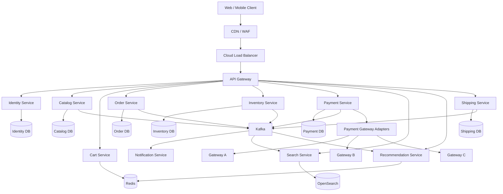
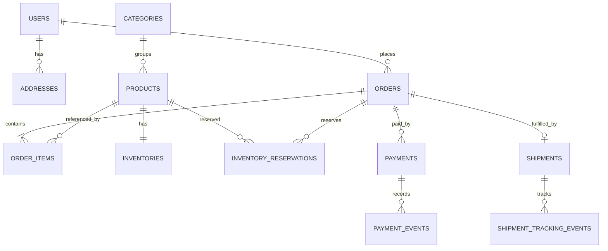
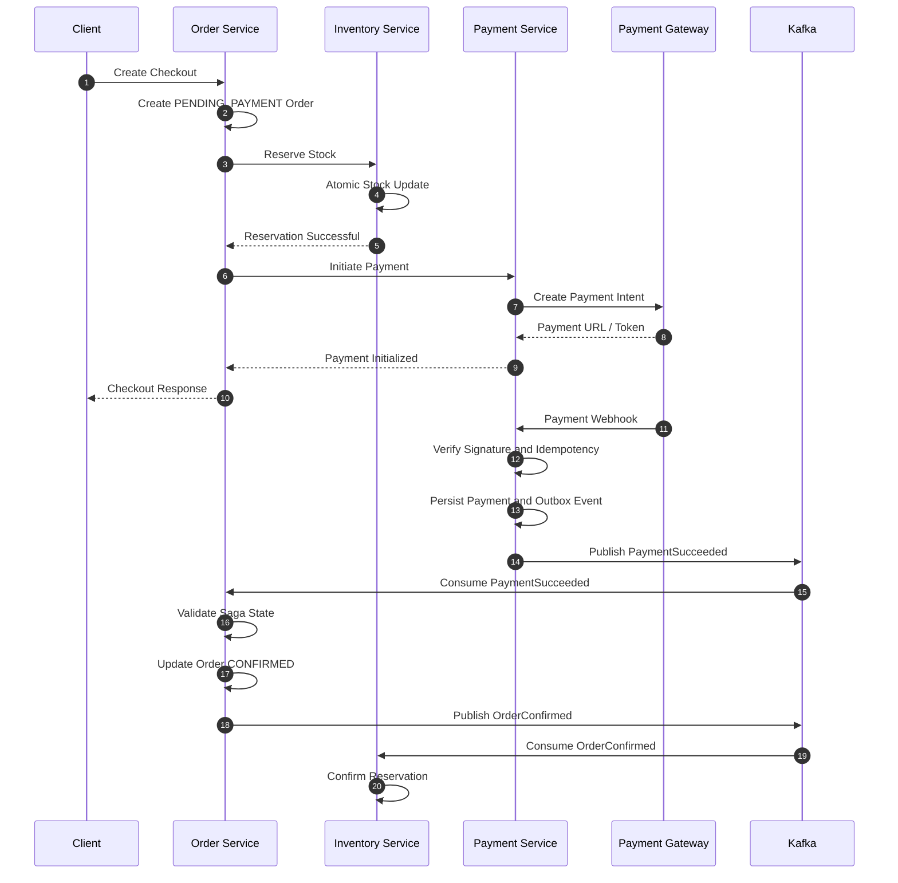
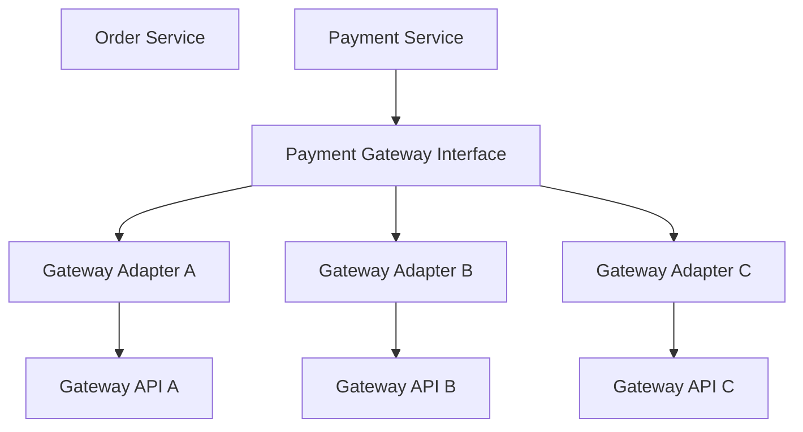
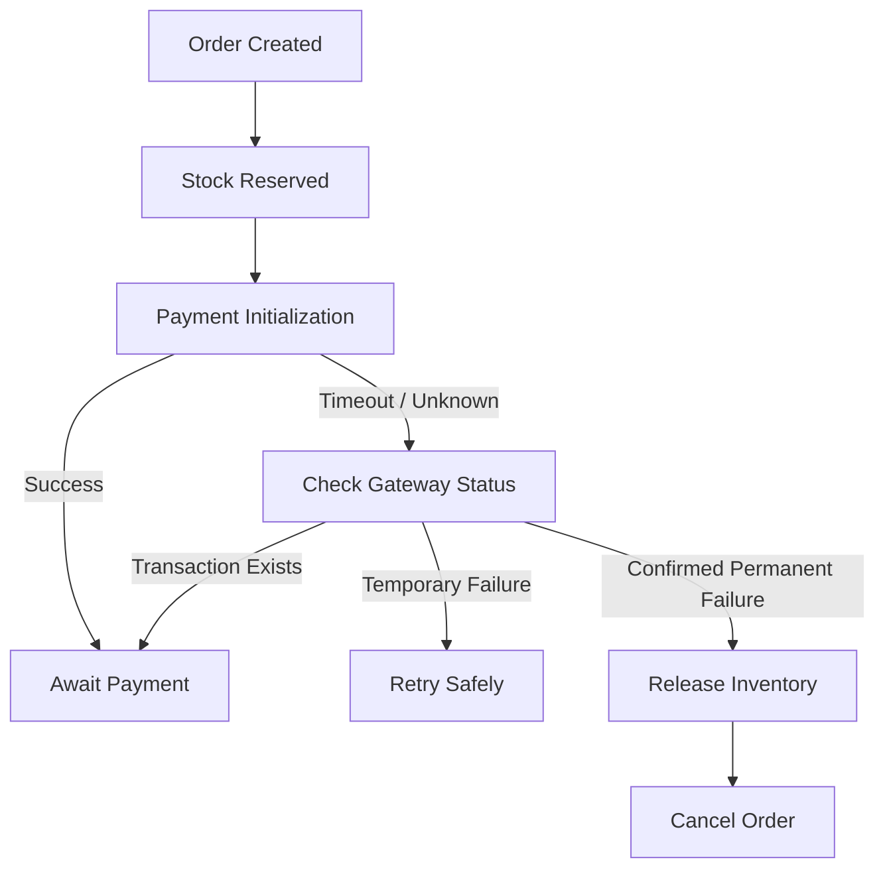
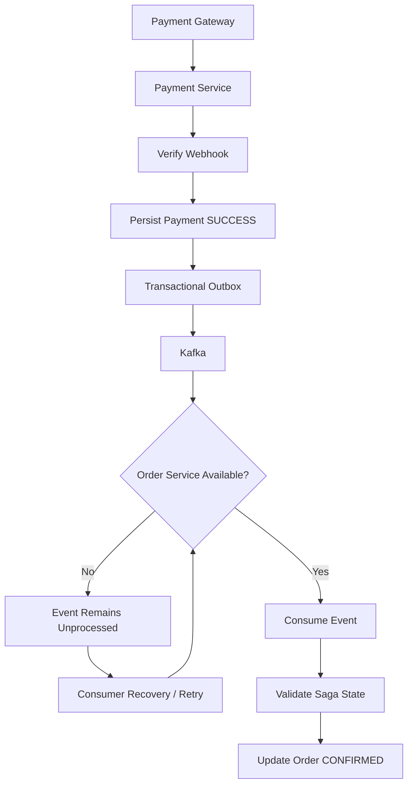
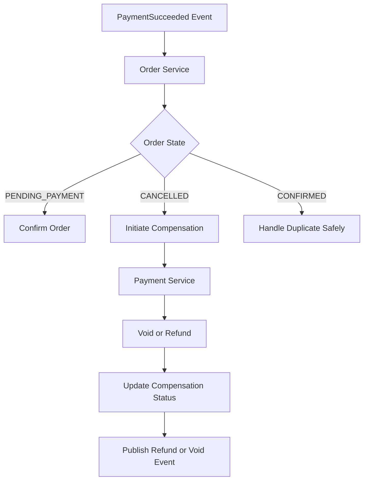
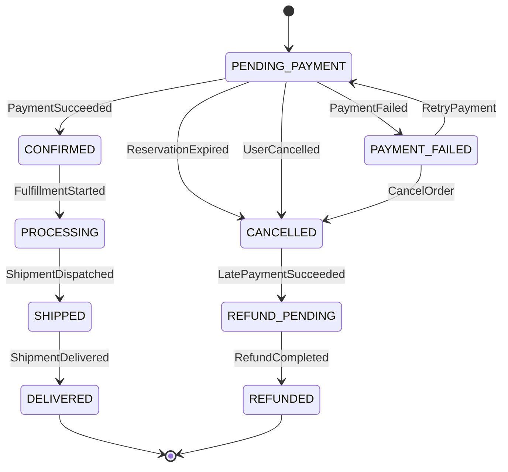
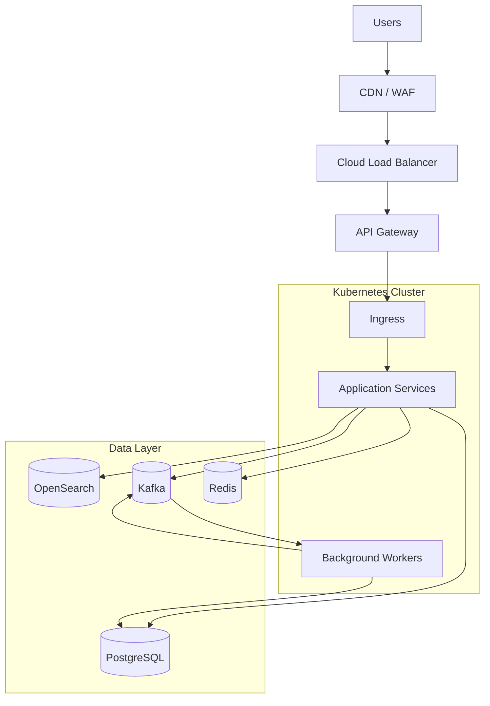

# Proposal Desain Arsitektur Sistem E-Commerce

- **Jenis Dokumen:** Proposal Desain Arsitektur Sistem
- **Arsitektur:** Domain-Driven Design (DDD), Microservices, Event-Driven Architecture (EDA)
- **Versi:** 1.0

---

## Daftar Isi

1. [Ringkasan Eksekutif](#1-ringkasan-eksekutif)
2. [Tujuan, Ruang Lingkup, dan Asumsi](#2-tujuan-ruang-lingkup-dan-asumsi)
3. [Prinsip dan Gaya Arsitektur](#3-prinsip-dan-gaya-arsitektur)
4. [High-Level Architecture](#4-high-level-architecture)
5. [Pembagian Domain dan Layanan](#5-pembagian-domain-dan-layanan)
6. [Rekomendasi Teknologi](#6-rekomendasi-teknologi)
7. [Desain Data dan Database](#7-desain-data-dan-database)
8. [API Specification](#8-api-specification)
9. [Alur Bisnis Utama](#9-alur-bisnis-utama)
10. [Konsistensi Inventaris](#10-konsistensi-inventaris)
11. [Pemrosesan Pembayaran](#11-pemrosesan-pembayaran)
12. [Saga dan Penanganan Kegagalan](#12-saga-dan-penanganan-kegagalan)
13. [Skalabilitas dan Performa](#13-skalabilitas-dan-performa)
14. [Reliability dan Fault Tolerance](#14-reliability-dan-fault-tolerance)
15. [Keamanan dan Kepatuhan](#15-keamanan-dan-kepatuhan)
16. [Observability](#16-observability)
17. [Capacity Planning dan Load Testing](#17-capacity-planning-dan-load-testing)
18. [Deployment dan Infrastruktur](#18-deployment-dan-infrastruktur)
19. [Risiko dan Trade-off](#19-risiko-dan-trade-off)
20. [Keputusan Arsitektur](#20-keputusan-arsitektur)
21. [Kesimpulan](#21-kesimpulan)
- [Lampiran A — Catatan Implementasi](#lampiran-a--catatan-implementasi)
- [Lampiran B — Referensi Teknologi](#lampiran-b--referensi-teknologi)

---

## 1. Ringkasan Eksekutif

Dokumen ini mengusulkan desain arsitektur sistem e-commerce yang skalabel, andal, aman, dan mudah dikembangkan untuk mendukung lebih dari **10.000 pengguna secara bersamaan**.

Arsitektur menggunakan pendekatan **Microservices** dengan **Domain-Driven Design (DDD)** untuk menetapkan batas tanggung jawab layanan berdasarkan domain bisnis. **Event-Driven Architecture (EDA)** digunakan untuk proses asynchronous, seperti pemrosesan pesanan, notifikasi pembayaran, pembaruan inventaris, pengiriman, dan pengindeksan produk.

Fokus utama desain:

- Skalabilitas horizontal untuk menangani pertumbuhan trafik.
- Isolasi kegagalan agar gangguan satu layanan tidak langsung menghentikan seluruh sistem.
- Konsistensi data pada transaksi kritis seperti inventaris dan pembayaran.
- Eventual consistency untuk komunikasi lintas layanan.
- Integrasi beberapa payment gateway melalui abstraksi yang konsisten.
- Keamanan, observability, dan kemudahan operasional.

Arsitektur ini merupakan rancangan awal. Kapasitas aktual, jumlah replica, dan konfigurasi infrastruktur harus divalidasi menggunakan profil beban kerja dan pengujian performa.

---

## 2. Tujuan, Ruang Lingkup, dan Asumsi

### 2.1 Tujuan

Sistem harus mampu:

1. Melayani lebih dari 10.000 concurrent users.
2. Mengelola katalog dan pencarian produk.
3. Mengelola shopping cart dan proses checkout.
4. Menjaga akurasi stok ketika banyak pengguna membeli produk yang sama.
5. Mendukung beberapa payment gateway.
6. Mengelola siklus hidup pesanan.
7. Menyediakan pelacakan pengiriman secara real-time atau near-real-time.
8. Menyediakan rekomendasi produk.
9. Memulihkan proses ketika terjadi kegagalan jaringan atau layanan.

### 2.2 Asumsi Desain

| Parameter | Asumsi |
| :--- | :--- |
| **Concurrent Users** | 10.000+ |
| **Client** | Web dan Mobile |
| **Arsitektur Aplikasi** | Microservices |
| **Backend** | Golang |
| **Database Transaksional** | PostgreSQL |
| **Cache** | Redis |
| **Message Broker** | Apache Kafka |
| **Search Engine** | OpenSearch |
| **Container** | Docker |
| **Orchestration** | Kubernetes |
| **Komunikasi** | REST/gRPC dan event asynchronous |
| **Availability Target Awal** | 99,9% |

> **Catatan:** Angka concurrent users bukan berarti sistem harus melayani 10.000 request per detik. RPS, throughput, dan kebutuhan resource harus dihitung dari pola aktivitas pengguna, rasio baca/tulis, serta tingkat konversi checkout.

### 2.3 Di Luar Ruang Lingkup

Detail berikut dapat dikembangkan pada fase lanjutan:

- Algoritma rekomendasi machine learning secara mendalam.
- Implementasi spesifik setiap payment gateway.
- Detail kontrak API seluruh provider kurir.
- Multi-region active-active deployment.
- Perhitungan biaya cloud secara rinci.

---

## 3. Prinsip dan Gaya Arsitektur

### 3.1 Domain-Driven Design

Pembagian layanan mengikuti *bounded context*, bukan sekadar pemisahan berdasarkan tabel atau layer teknis.

Setiap layanan memiliki:

- Tanggung jawab bisnis yang jelas.
- Model domain dan aturan bisnis sendiri.
- Kepemilikan data sendiri.
- Kontrak API atau event yang terdefinisi.
- Siklus deployment yang independen.

### 3.2 Microservices

Microservices dipilih untuk memungkinkan layanan kritis seperti Catalog, Search, Order, dan Inventory di-scale secara independen. Pemisahan layanan juga membantu isolasi kegagalan dan pengembangan oleh tim yang berbeda.

Trade-off yang perlu diperhatikan adalah meningkatnya kompleksitas operasional, observability, deployment, dan konsistensi data lintas layanan. Karena itu, pemecahan layanan harus tetap berdasarkan kebutuhan domain yang nyata.

### 3.3 Event-Driven Architecture

Event digunakan untuk menyebarkan fakta bisnis yang sudah terjadi, misalnya:

- `ProductCreated`
- `ProductUpdated`
- `OrderCreated`
- `InventoryReserved`
- `PaymentSucceeded`
- `PaymentFailed`
- `OrderConfirmed`
- `ShipmentDispatched`
- `ShipmentDelivered`

Event tidak digunakan untuk menggantikan seluruh komunikasi synchronous. Request yang membutuhkan hasil langsung tetap dapat menggunakan REST atau gRPC.

### 3.4 Prinsip Konsistensi

- **Strong consistency** di dalam transaksi database milik satu layanan.
- **Eventual consistency** untuk sinkronisasi data lintas layanan.
- Setiap domain memiliki satu *source of truth*.
- Event delivery diasumsikan *at-least-once*.
- Consumer harus *idempotent*.
- Tidak mengandalkan distributed lock sebagai satu-satunya mekanisme integritas stok.

---

## 4. High-Level Architecture

### 4.1 Diagram Arsitektur



Diagram ini menggambarkan batas layanan dan aliran komunikasi secara logical. Detail jaringan, deployment, dan topologi database dijelaskan pada bagian infrastruktur.

### 4.2 Lapisan Arsitektur

| Lapisan | Tanggung Jawab |
| :--- | :--- |
| **Client** | Antarmuka pengguna web dan mobile |
| **Edge** | CDN, WAF, proteksi trafik, TLS termination |
| **API Gateway** | Routing, rate limiting, autentikasi awal, request policy |
| **Application Services** | Aturan bisnis dan use case setiap domain |
| **Messaging** | Distribusi event dan pemrosesan asynchronous |
| **Data** | Database, cache, dan search index |
| **External Integration** | Payment gateway dan provider pengiriman |
| **Observability** | Metrics, logs, tracing, dan alerting |

---

## 5. Pembagian Domain dan Layanan

| Layanan | Tanggung Jawab | Data yang Dimiliki |
| :--- | :--- | :--- |
| **Identity Service** | Autentikasi, otorisasi, manajemen pengguna | User, credential, role |
| **Catalog Service** | Produk, kategori, atribut, harga katalog | Product, category |
| **Cart Service** | Keranjang belanja | Cart dan cart items |
| **Inventory Service** | Stok, reservasi, pelepasan stok | Inventory, reservation |
| **Order Service** | Pembuatan pesanan dan lifecycle order | Order, order items, saga state |
| **Payment Service** | Payment orchestration dan integrasi gateway | Payment, payment events |
| **Shipping Service** | Pembuatan pengiriman dan tracking | Shipment, tracking events |
| **Search Service** | Pencarian dan indeks produk | Search index |
| **Recommendation Service** | Rekomendasi produk | Recommendation features/results |
| **Notification Service** | Email, WhatsApp, SMS, push notification | Notification jobs dan delivery status |

### 5.1 Aturan Kepemilikan Data

Setiap layanan menjadi satu-satunya pemilik data domainnya. Layanan lain tidak boleh melakukan query langsung ke database tersebut.

Jika layanan lain membutuhkan informasi, gunakan:

- **API** untuk kebutuhan query yang membutuhkan respons langsung.
- **Event** untuk kebutuhan sinkronisasi atau proses asynchronous.
- **Read model lokal** jika dibutuhkan untuk menghindari query lintas layanan yang berulang.

---

## 6. Rekomendasi Teknologi

| Komponen | Teknologi | Alasan |
| :--- | :--- | :--- |
| **Backend** | Golang | Concurrency dan penggunaan resource yang efisien |
| **API Gateway** | Kong atau Managed API Gateway | Routing, rate limiting, dan policy |
| **Komunikasi Synchronous** | REST / gRPC | REST untuk API publik; gRPC untuk komunikasi internal yang sesuai |
| **Message Broker** | Apache Kafka | Event streaming dan durable message log |
| **Database Transaksional** | PostgreSQL | ACID transaction dan relational integrity |
| **Cache** | Redis | Cache, cart, dan data sementara |
| **Search** | OpenSearch | Full-text search dan filtering |
| **Container** | Docker | Packaging aplikasi |
| **Orchestration** | Kubernetes | Scheduling, recovery, dan autoscaling |
| **Metrics** | Prometheus + Grafana | Monitoring metrik |
| **Tracing** | OpenTelemetry | Distributed tracing |
| **Logging** | Centralized Logging Platform | Agregasi log |
| **CI/CD** | GitHub Actions atau platform setara | Otomatisasi build, test, dan deployment |

Pemilihan teknologi merupakan rekomendasi awal. Keputusan akhir harus mempertimbangkan kemampuan tim, biaya operasional, kebutuhan throughput, dan layanan cloud yang tersedia.

---

## 7. Desain Data dan Database

Setiap layanan memiliki database atau logical datastore yang menjadi tanggung jawabnya. Untuk deployment, database dapat menggunakan cluster PostgreSQL yang sama pada tahap awal dengan pemisahan database, credential, dan hak akses yang ketat. Pemisahan cluster dapat dilakukan ketika kebutuhan skalabilitas atau isolasi sudah membenarkannya.

### 7.1 Identity Database

#### Tabel `users`

| Kolom | Tipe | Keterangan |
| :--- | :--- | :--- |
| `id` | `UUID` | Primary key |
| `email` | `VARCHAR` | Email pengguna, unique |
| `password_hash` | `VARCHAR` | Password hash |
| `full_name` | `VARCHAR` | Nama pengguna |
| `status` | `VARCHAR` | Status akun |
| `created_at` | `TIMESTAMP` | Waktu pembuatan |
| `updated_at` | `TIMESTAMP` | Waktu perubahan |

#### Tabel `addresses`

| Kolom | Tipe | Keterangan |
| :--- | :--- | :--- |
| `id` | `UUID` | Primary key |
| `user_id` | `UUID` | Referensi user |
| `recipient_name` | `VARCHAR` | Nama penerima |
| `address` | `TEXT` | Alamat |
| `city` | `VARCHAR` | Kota |
| `postal_code` | `VARCHAR` | Kode pos |
| `is_default` | `BOOLEAN` | Alamat utama |

`user_id` merupakan referensi logis ke Identity Service. Relasi ini tidak memerlukan foreign key lintas database.

### 7.2 Catalog Database

#### Tabel `products`

| Kolom | Tipe | Keterangan |
| :--- | :--- | :--- |
| `id` | `UUID` | Primary key |
| `sku` | `VARCHAR` | SKU, unique |
| `name` | `VARCHAR` | Nama produk |
| `description` | `TEXT` | Deskripsi |
| `category_id` | `UUID` | Referensi kategori |
| `price` | `DECIMAL(18,2)` | Harga katalog |
| `status` | `VARCHAR` | Status produk |
| `created_at` | `TIMESTAMP` | Waktu pembuatan |
| `updated_at` | `TIMESTAMP` | Waktu perubahan |

#### Tabel `categories`

| Kolom | Tipe | Keterangan |
| :--- | :--- | :--- |
| `id` | `UUID` | Primary key |
| `name` | `VARCHAR` | Nama kategori |
| `parent_id` | `UUID` | Kategori induk |
| `status` | `VARCHAR` | Status kategori |

Harga pada Catalog merupakan harga katalog. Pada saat checkout, Order Service harus menyimpan snapshot harga yang digunakan untuk transaksi. Jika bisnis memiliki promosi atau pricing engine terpisah, sumber harga final perlu didefinisikan secara eksplisit.

### 7.3 Inventory Database

#### Tabel `inventories`

| Kolom | Tipe | Keterangan |
| :--- | :--- | :--- |
| `id` | `UUID` | Primary key |
| `product_id` | `UUID` | ID produk dari Catalog |
| `available_stock` | `INTEGER` | Stok yang dapat dipesan |
| `reserved_stock` | `INTEGER` | Stok yang sedang direservasi |
| `version` | `BIGINT` | Versi untuk concurrency control |
| `updated_at` | `TIMESTAMP` | Waktu perubahan |

#### Tabel `inventory_reservations`

| Kolom | Tipe | Keterangan |
| :--- | :--- | :--- |
| `id` | `UUID` | Primary key |
| `order_id` | `UUID` | Referensi order |
| `product_id` | `UUID` | Referensi produk |
| `quantity` | `INTEGER` | Jumlah stok |
| `status` | `VARCHAR` | `RESERVED`, `CONFIRMED`, `RELEASED`, `EXPIRED` |
| `expires_at` | `TIMESTAMP` | Batas waktu reservasi |
| `created_at` | `TIMESTAMP` | Waktu pembuatan |
| `updated_at` | `TIMESTAMP` | Waktu perubahan |

**Constraint dan Index:**

- Unique constraint pada `inventories.product_id` jika satu baris mewakili satu SKU/lokasi stok.
- Check constraint agar `available_stock >= 0` dan `reserved_stock >= 0`.
- Index pada `inventory_reservations(order_id)`.
- Index pada `inventory_reservations(status, expires_at)`.
- Idempotency key atau unique business key untuk mencegah reservasi order yang sama dibuat berulang.

Jika sistem mendukung banyak gudang, kunci unik inventaris perlu mencakup `product_id` dan `warehouse_id`.

### 7.4 Order Database

#### Tabel `orders`

| Kolom | Tipe | Keterangan |
| :--- | :--- | :--- |
| `id` | `UUID` | Primary key |
| `user_id` | `UUID` | Referensi user |
| `order_number` | `VARCHAR` | Nomor order, unique |
| `status` | `VARCHAR` | Status order |
| `subtotal` | `DECIMAL(18,2)` | Subtotal |
| `total_amount` | `DECIMAL(18,2)` | Total pembayaran |
| `shipping_address` | `JSONB` | Snapshot alamat |
| `created_at` | `TIMESTAMP` | Waktu pembuatan |
| `updated_at` | `TIMESTAMP` | Waktu perubahan |

#### Tabel `order_items`

| Kolom | Tipe | Keterangan |
| :--- | :--- | :--- |
| `id` | `UUID` | Primary key |
| `order_id` | `UUID` | Referensi order |
| `product_id` | `UUID` | Referensi produk |
| `product_name` | `VARCHAR` | Snapshot nama produk |
| `unit_price` | `DECIMAL(18,2)` | Snapshot harga |
| `quantity` | `INTEGER` | Jumlah |
| `subtotal` | `DECIMAL(18,2)` | Subtotal item |

Snapshot nama, harga, dan atribut relevan menjaga riwayat transaksi tetap akurat meskipun katalog berubah.

### 7.5 Payment Database

#### Tabel `payments`

| Kolom | Tipe | Keterangan |
| :--- | :--- | :--- |
| `id` | `UUID` | Primary key |
| `order_id` | `UUID` | Referensi order |
| `gateway` | `VARCHAR` | Provider pembayaran |
| `gateway_transaction_id` | `VARCHAR` | ID transaksi provider |
| `amount` | `DECIMAL(18,2)` | Nominal |
| `status` | `VARCHAR` | Status pembayaran |
| `idempotency_key` | `VARCHAR` | Kunci idempotensi |
| `created_at` | `TIMESTAMP` | Waktu pembuatan |
| `updated_at` | `TIMESTAMP` | Waktu perubahan |

#### Tabel `payment_events`

| Kolom | Tipe | Keterangan |
| :--- | :--- | :--- |
| `id` | `UUID` | Primary key |
| `gateway_event_id` | `VARCHAR` | ID event dari gateway |
| `payment_id` | `UUID` | Referensi payment |
| `event_type` | `VARCHAR` | Jenis event |
| `payload` | `JSONB` | Payload yang sudah disanitasi |
| `processed_at` | `TIMESTAMP` | Waktu pemrosesan |

#### Tabel `outbox_events`

| Kolom | Tipe | Keterangan |
| :--- | :--- | :--- |
| `id` | `UUID` | Event ID |
| `aggregate_id` | `UUID` | ID aggregate |
| `event_type` | `VARCHAR` | Jenis event |
| `payload` | `JSONB` | Payload event |
| `status` | `VARCHAR` | `PENDING` / `PUBLISHED` |
| `created_at` | `TIMESTAMP` | Waktu dibuat |
| `published_at` | `TIMESTAMP` | Waktu diterbitkan |

Terapkan unique constraint pada identitas event gateway dan idempotency key sesuai cakupan bisnisnya. Payload webhook harus disimpan dengan memperhatikan kebijakan keamanan, retensi, dan minimisasi data sensitif.

### 7.6 Shipping Database

#### Tabel `shipments`

| Kolom | Tipe | Keterangan |
| :--- | :--- | :--- |
| `id` | `UUID` | Primary key |
| `order_id` | `UUID` | Referensi order |
| `tracking_number` | `VARCHAR` | Nomor pelacakan |
| `courier` | `VARCHAR` | Provider kurir |
| `status` | `VARCHAR` | Status pengiriman |
| `shipped_at` | `TIMESTAMP` | Waktu dikirim |
| `delivered_at` | `TIMESTAMP` | Waktu diterima |

#### Tabel `shipment_tracking_events`

| Kolom | Tipe | Keterangan |
| :--- | :--- | :--- |
| `id` | `UUID` | Primary key |
| `shipment_id` | `UUID` | Referensi shipment |
| `status` | `VARCHAR` | Status tracking |
| `description` | `TEXT` | Deskripsi |
| `occurred_at` | `TIMESTAMP` | Waktu kejadian |

### 7.7 ERD Konseptual

Diagram berikut menggambarkan relasi konseptual. Karena database dimiliki oleh layanan berbeda, beberapa relasi merupakan referensi logis dan bukan foreign key lintas database.



---

## 8. API Specification

Seluruh API publik diakses melalui API Gateway dengan base path `/api/v1`.

Autentikasi menggunakan access token. API yang mengubah data harus menerapkan validasi input, otorisasi, dan idempotency sesuai kebutuhan.

### 8.1 Identity API

| Method | Endpoint | Deskripsi |
| :---: | :--- | :--- |
| `POST` | `/auth/register` | Registrasi pengguna |
| `POST` | `/auth/login` | Autentikasi pengguna |
| `POST` | `/auth/refresh` | Memperbarui access token |
| `GET` | `/users/me` | Mendapatkan profil pengguna |

### 8.2 Catalog API

| Method | Endpoint | Deskripsi |
| :---: | :--- | :--- |
| `GET` | `/products` | Daftar produk |
| `GET` | `/products/{id}` | Detail produk |
| `GET` | `/categories` | Daftar kategori |
| `POST` | `/products` | Membuat produk (admin) |
| `PATCH` | `/products/{id}` | Memperbarui produk (admin) |

### 8.3 Cart API

| Method | Endpoint | Deskripsi |
| :---: | :--- | :--- |
| `GET` | `/cart` | Mendapatkan keranjang |
| `POST` | `/cart/items` | Menambahkan item |
| `PATCH` | `/cart/items/{id}` | Memperbarui item |
| `DELETE` | `/cart/items/{id}` | Menghapus item |

### 8.4 Inventory API

| Method | Endpoint | Deskripsi |
| :---: | :--- | :--- |
| `GET` | `/inventory/{product_id}` | Memeriksa ketersediaan stok |
| `POST` | `/inventory/reservations` | Membuat reservasi |
| `GET` | `/inventory/reservations/{id}` | Mendapatkan reservasi |
| `POST` | `/inventory/reservations/{id}/confirm` | Mengonfirmasi reservasi |
| `POST` | `/inventory/reservations/{id}/release` | Melepaskan reservasi |

### 8.5 Order API

| Method | Endpoint | Deskripsi |
| :---: | :--- | :--- |
| `POST` | `/orders` | Membuat pesanan / checkout |
| `GET` | `/orders` | Daftar pesanan pengguna |
| `GET` | `/orders/{id}` | Detail pesanan |
| `POST` | `/orders/{id}/cancel` | Membatalkan pesanan |

### 8.6 Payment API

| Method | Endpoint | Deskripsi |
| :---: | :--- | :--- |
| `POST` | `/payments` | Memulai pembayaran |
| `GET` | `/payments/{id}` | Status pembayaran |
| `POST` | `/payments/webhooks/{gateway}` | Menerima webhook gateway |

Endpoint inisiasi pembayaran harus menerima header `Idempotency-Key`. Endpoint webhook tidak menggunakan autentikasi pengguna biasa, tetapi wajib memverifikasi signature dan mekanisme autentikasi yang ditetapkan provider.

### 8.7 Search dan Recommendation API

| Method | Endpoint | Deskripsi |
| :---: | :--- | :--- |
| `GET` | `/search/products` | Mencari produk |
| `GET` | `/search/suggestions` | Saran pencarian |
| `GET` | `/recommendations` | Rekomendasi produk |

### 8.8 Shipping API

| Method | Endpoint | Deskripsi |
| :---: | :--- | :--- |
| `GET` | `/shipments/{order_id}` | Detail pengiriman |
| `GET` | `/shipments/{id}/tracking` | Riwayat tracking |

---

## 9. Alur Bisnis Utama

### 9.1 Alur Checkout

Checkout menggunakan **Saga Orchestration**. Order Service bertindak sebagai Saga Coordinator karena memiliki tanggung jawab atas lifecycle pesanan.



### 9.2 Alur Pengiriman

1. Order Service menerbitkan `OrderConfirmed`.
2. Shipping Service menerima event.
3. Shipping Service membuat shipment dan meminta provider kurir membuat pengiriman.
4. Shipping Service menyimpan nomor resi dan status awal.
5. Update dari provider kurir diterima melalui webhook atau polling.
6. Shipping Service menyimpan tracking event.
7. Shipping Service menerbitkan event perubahan status.
8. Notification Service mengirim informasi kepada pengguna.

---

## 10. Konsistensi Inventaris

Konsistensi inventaris sangat penting untuk mencegah *overselling* ketika banyak pengguna melakukan checkout untuk produk yang sama.

### 10.1 Strategi Atomic Database Update

Gunakan conditional update agar validasi stok dan perubahan stok dilakukan sebagai satu operasi atomik.

Contoh PostgreSQL:

```sql
UPDATE inventories
SET
    available_stock = available_stock - :quantity,
    reserved_stock = reserved_stock + :quantity,
    updated_at = NOW()
WHERE product_id = :product_id
  AND available_stock >= :quantity;
```

Aplikasi memeriksa jumlah baris yang terpengaruh:

- `affected_rows = 1`: reservasi berhasil.
- `affected_rows = 0`: stok tidak mencukupi atau produk tidak ditemukan.

Database akan mengelola row-level locking yang diperlukan untuk operasi update. Ketika transaksi lain menunggu row yang sama, kondisi update dievaluasi terhadap versi data terbaru sesuai isolation semantics PostgreSQL.

### 10.2 Transaksi Reservasi

Perubahan stok dan pembuatan reservation record harus berada dalam satu transaksi database.

```sql
BEGIN;

UPDATE inventories
SET
    available_stock = available_stock - :quantity,
    reserved_stock = reserved_stock + :quantity,
    updated_at = NOW()
WHERE product_id = :product_id
  AND available_stock >= :quantity;

-- Aplikasi harus memeriksa affected rows.
-- Jika bukan satu baris, lakukan ROLLBACK.

INSERT INTO inventory_reservations (
    id,
    order_id,
    product_id,
    quantity,
    status,
    expires_at,
    created_at
)
VALUES (
    :reservation_id,
    :order_id,
    :product_id,
    :quantity,
    'RESERVED',
    NOW() + INTERVAL '15 minutes',
    NOW()
);

COMMIT;
```

Contoh tersebut perlu dijalankan dengan pengecekan affected rows di dalam aplikasi. Jika stok tidak mencukupi, transaksi harus di-rollback dan reservation tidak boleh dibuat.

Untuk order yang memiliki beberapa item, semua reservasi item sebaiknya dilakukan dalam satu transaksi Inventory Service atau menggunakan mekanisme orkestrasi yang secara eksplisit menangani reservasi parsial. Urutan penguncian item perlu dibuat konsisten untuk mengurangi risiko deadlock.

### 10.3 Siklus Reservasi

- `RESERVED`: Stok telah ditahan sementara.
- `CONFIRMED`: Pembayaran berhasil dan reservasi dikonfirmasi.
- `RELEASED`: Reservasi dilepas karena pembatalan atau kegagalan.
- `EXPIRED`: Batas waktu reservasi terlewati.

Worker berkala mencari reservasi kedaluwarsa. Perubahan status reservasi dan pengembalian stok harus dilakukan secara atomik dan idempotent.

Redis dapat digunakan untuk cache ketersediaan stok, tetapi bukan sebagai satu-satunya sumber kebenaran untuk keputusan checkout.

---

## 11. Pemrosesan Pembayaran

### 11.1 Payment Adapter

Payment Service menggunakan **Adapter Pattern** agar setiap payment gateway mengikuti kontrak internal yang sama.



Kontrak internal dapat mencakup:

- `CreatePayment()`
- `GetPaymentStatus()`
- `CancelPayment()`
- `RefundPayment()`

Setiap adapter bertanggung jawab menerjemahkan request dan response provider ke model internal. Perbedaan kemampuan provider, seperti dukungan void, refund, expiry, dan webhook, harus dimodelkan secara eksplisit.

### 11.2 Webhook Reliability

Payment Gateway hanya mengirim webhook ke Payment Service, bukan langsung ke Order Service.

Tahapan pemrosesan:

1. Menerima webhook.
2. Memverifikasi signature dan sumber request.
3. Memvalidasi identitas event dan transaksi.
4. Memeriksa idempotency.
5. Memvalidasi nominal, mata uang, dan referensi order.
6. Menyimpan status pembayaran dan outbox event dalam satu transaksi database.
7. Mengirim HTTP success setelah data berhasil disimpan secara durable.
8. Outbox Publisher menerbitkan event ke Kafka.
9. Order Service mengonsumsi event dan memperbarui status order.

Payment Service adalah *source of truth* untuk status pembayaran. Order Service adalah *source of truth* untuk status pesanan.

### 11.3 Transactional Outbox

Transactional Outbox mencegah kondisi ketika perubahan database berhasil tetapi event gagal diterbitkan ke message broker.

Dalam satu transaksi database:

```sql
BEGIN;

UPDATE payments
SET
    status = 'SUCCESS',
    updated_at = NOW()
WHERE id = :payment_id;

INSERT INTO outbox_events (
    id,
    aggregate_id,
    event_type,
    payload,
    status,
    created_at
)
VALUES (
    :event_id,
    :payment_id,
    'PaymentSucceeded',
    :payload,
    'PENDING',
    NOW()
);

COMMIT;
```

Outbox Publisher mengambil event berstatus `PENDING`, menerbitkannya ke Kafka, lalu menandai event sebagai `PUBLISHED`.

Jika Kafka tidak tersedia, event tetap tersimpan di database dan dapat dicoba kembali.

Publisher dapat menerbitkan event lebih dari satu kali jika terjadi crash setelah Kafka menerima event tetapi sebelum status outbox diperbarui. Karena itu consumer wajib idempotent.

### 11.4 Payment Reconciliation

Payment Reconciliation Worker secara berkala memeriksa transaksi yang masih pending atau memiliki status yang tidak pasti dengan menanyakan status langsung ke provider.

Mekanisme ini menangani:

- Webhook terlambat atau tidak diterima.
- Gangguan jaringan.
- Ketidakpastian hasil request ke gateway.
- Kegagalan pemrosesan event.

Reconciliation tidak boleh mengubah status pembayaran secara sembarangan. Transisi status harus mengikuti state machine dan bukti status dari provider.

---

## 12. Saga dan Penanganan Kegagalan

### 12.1 Peran Saga Coordinator

Order Service bertindak sebagai Saga Coordinator karena mengelola lifecycle order dan mengetahui tahapan checkout.

| Komponen | Tanggung Jawab |
| :--- | :--- |
| **Order Service** | Mengorkestrasi checkout dan menyimpan state Saga |
| **Inventory Service** | Reservasi, konfirmasi, dan pelepasan stok |
| **Payment Service** | Membuat transaksi dan mengelola status pembayaran |
| **Kafka** | Distribusi event antar layanan |
| **Outbox Publisher** | Menerbitkan event yang tersimpan di outbox |
| **Reconciliation Worker** | Memeriksa status transaksi yang tidak pasti |

### 12.2 Saga Persistence

State Saga harus disimpan secara durable agar proses dapat dilanjutkan setelah service restart.

#### Tabel `order_sagas`

| Kolom | Tipe | Keterangan |
| :--- | :--- | :--- |
| `id` | `UUID` | Saga ID |
| `order_id` | `UUID` | Referensi order |
| `current_step` | `VARCHAR` | Tahapan Saga |
| `status` | `VARCHAR` | `RUNNING`, `COMPLETED`, `COMPENSATING`, `FAILED` |
| `last_error` | `TEXT` | Error terakhir |
| `started_at` | `TIMESTAMP` | Waktu mulai |
| `completed_at` | `TIMESTAMP` | Waktu selesai |
| `updated_at` | `TIMESTAMP` | Waktu perubahan |

Perubahan state Saga dan pembuatan command/event berikutnya harus dilakukan secara atomik dengan outbox pada database Order Service.

### 12.3 Skenario A: Payment Initialization Gagal

**Kondisi:**

1. Order berhasil dibuat.
2. Inventory berhasil melakukan reservasi.
3. Payment Gateway gagal membuat payment intent.

**Penanganan:**



**Urutan kompensasi:**

1. Order Service mencatat kegagalan atau hasil yang belum pasti.
2. Jika hasil request tidak pasti, Payment Service melakukan pengecekan status atau retry menggunakan idempotency key yang sama.
3. Jika kegagalan dipastikan permanen dan tidak ada transaksi aktif, Order Service memulai kompensasi.
4. Inventory Service melepaskan reservasi.
5. Order Service mengubah status menjadi `PAYMENT_FAILED` atau `CANCELLED`.

> **Penting:** Timeout saat memanggil gateway tidak membuktikan bahwa transaksi gagal. Gateway mungkin sudah membuat transaksi tetapi response tidak sampai. Jangan melepaskan stok sebelum status transaksi dipastikan atau kebijakan bisnis menangani ketidakpastian tersebut.

### 12.4 Skenario B: Payment Berhasil, Order Service Down

**Kondisi:**

1. Pengguna berhasil membayar.
2. Payment Gateway mengirim webhook.
3. Payment Service berhasil menyimpan status `SUCCESS`.
4. Outbox event berhasil disimpan.
5. Event diterbitkan ke Kafka.
6. Order Service sedang down.

**Penanganan:**



Payment Service tidak perlu menunggu Order Service tersedia untuk menyimpan keberhasilan pembayaran. Event akan diproses ketika consumer kembali aktif.

Gunakan consumer group, offset management, retry terkontrol, dan monitoring consumer lag. Event harus tetap tersedia sesuai retention policy Kafka dan kebijakan pemulihan.

### 12.5 Skenario C: Payment Berhasil Setelah Order Dibatalkan

Ini merupakan edge case penting.

**Kondisi:**

1. User melakukan checkout.
2. Stok berhasil direservasi.
3. Pembayaran belum selesai.
4. Reservation kedaluwarsa.
5. Order dibatalkan.
6. Webhook `PaymentSucceeded` diterima terlambat.

**Penanganan:**

1. Payment Service tetap mencatat status pembayaran sebagai `SUCCESS` jika sudah dikonfirmasi provider.
2. Order Service mendeteksi bahwa order sudah `CANCELLED`.
3. Order Service tidak mengubah order menjadi `CONFIRMED`.
4. Order Service memulai proses kompensasi pembayaran.
5. Payment Service melakukan void atau refund sesuai status transaksi dan kemampuan provider.
6. Hasil kompensasi dicatat dan dipantau sampai selesai.



Refund dan void bukan operasi yang selalu sama. Pemilihannya bergantung pada status transaksi dan kemampuan payment gateway.

### 12.6 Order State Machine



Transisi status harus divalidasi dan dilakukan secara atomik. Contoh conditional update:

```sql
UPDATE orders
SET
    status = 'CONFIRMED',
    updated_at = NOW()
WHERE id = :order_id
  AND status = 'PENDING_PAYMENT';
```

Jika tidak ada baris yang berubah, aplikasi harus membaca state terbaru dan menentukan apakah event merupakan duplikasi, sudah diproses, atau membutuhkan kompensasi.

### 12.7 Idempotent Consumer

Setiap consumer perlu mencatat event yang telah diproses, misalnya melalui tabel `processed_events` dengan unique constraint pada `consumer_name` dan `event_id`.

Pencatatan event dan perubahan data bisnis harus berada dalam satu transaksi database. Jika event sudah tercatat, consumer tidak mengulangi efek bisnisnya dan dapat menyelesaikan acknowledgment/offset sesuai mekanisme yang digunakan.

---

## 13. Skalabilitas dan Performa

### 13.1 Horizontal Scaling

Layanan aplikasi dirancang stateless sejauh memungkinkan. Kubernetes Horizontal Pod Autoscaler (HPA) dapat menambah atau mengurangi replica berdasarkan CPU, memory, request rate, latency, atau metrik khusus.

Contoh nilai awal untuk pengujian (bukan ukuran kapasitas final):

| Service | Replica Awal | Metrik Scaling |
| :--- | :---: | :--- |
| **API Gateway** | 3 | CPU, request rate |
| **Catalog** | 3 | CPU, latency |
| **Order** | 3 | CPU, request rate |
| **Inventory** | 3 | CPU, latency, DB saturation |
| **Payment** | 3 | CPU, request rate |
| **Search** | 3 | CPU, latency |
| **Notification** | 2 | Queue backlog |

Autoscaling aplikasi tidak otomatis menyelesaikan bottleneck database. Kapasitas database, connection pool, dan batas koneksi harus direncanakan bersama.

### 13.2 Caching

Redis digunakan untuk:

- Cache detail produk.
- Cache kategori.
- Shopping cart.
- Session atau data sementara.
- Konfigurasi yang sering dibaca.

Cache invalidation dilakukan melalui event atau mekanisme TTL yang sesuai.

Data stok yang ditampilkan di katalog dapat bersifat sedikit tertunda. Namun, keputusan akhir saat checkout selalu divalidasi terhadap Inventory Service.

### 13.3 Optimasi Database

- Index berdasarkan pola query aktual.
- Connection pooling.
- Read replica untuk beban baca yang sesuai.
- Cursor-based pagination untuk dataset besar.
- Hindari join lintas service.
- Analisis query menggunakan `EXPLAIN ANALYZE`.
- Partitioning untuk tabel besar jika terbukti bermanfaat.
- Retention dan archival untuk data event/audit sesuai kebijakan.

### 13.4 Search

Catalog Service menerbitkan event perubahan produk. Search Service mengonsumsi event dan memperbarui OpenSearch.

Search index merupakan read model, bukan *source of truth*. Jika indeks tertinggal atau rusak, indeks dapat dibangun ulang dari sumber data Catalog melalui mekanisme reindexing.

### 13.5 Recommendation

Recommendation Service dapat dimulai dengan pendekatan sederhana seperti popular products, category affinity, atau item-based recommendation. Model machine learning dapat ditambahkan ketika data perilaku dan kebutuhan bisnis sudah memadai.

---

## 14. Reliability dan Fault Tolerance

### 14.1 Resilience Pattern

- Timeout untuk komunikasi eksternal.
- Retry dengan exponential backoff dan jitter.
- Circuit breaker.
- Bulkhead untuk membatasi dampak kegagalan.
- Rate limiting.
- Health check dan readiness probe.
- Graceful shutdown.
- Dead Letter Queue/Topic untuk pesan yang gagal diproses.

Retry hanya diterapkan pada kegagalan yang dapat dicoba kembali. Operasi non-idempotent harus dilindungi dengan idempotency key atau mekanisme deduplikasi.

### 14.2 Kafka Reliability

- Replication factor dan min in-sync replicas ditetapkan sesuai target durability.
- Producer menggunakan konfigurasi acknowledgment yang sesuai kebutuhan durability.
- Consumer mengelola offset setelah efek bisnis berhasil disimpan.
- Consumer idempotent untuk menghadapi redelivery.
- Retry topic atau mekanisme retry terkontrol.
- Dead Letter Topic untuk pesan yang gagal diproses permanen.
- Monitoring consumer lag dan jumlah retry.

Untuk menjaga urutan event per order, gunakan `order_id` sebagai message key. Desain partition dan consumer concurrency harus mempertimbangkan kebutuhan ordering tersebut.

### 14.3 Availability dan Recovery

Target availability awal yang direkomendasikan adalah **99,9%**, dengan definisi pengukuran yang disepakati.

Pertimbangan:

- Beberapa replica aplikasi.
- Deployment lintas availability zone jika tersedia.
- Database backup dan point-in-time recovery.
- Database replication.
- Kafka replication.
- Redis high availability.
- Prosedur disaster recovery.
- Pengujian pemulihan berkala.

RPO dan RTO harus ditentukan berdasarkan kebutuhan bisnis dan biaya infrastruktur.

---

## 15. Keamanan dan Kepatuhan

### 15.1 Autentikasi dan Otorisasi

- JWT atau mekanisme token yang sesuai.
- Role-Based Access Control (RBAC).
- Access token berumur pendek.
- Refresh token dikelola secara aman.
- Service-to-service authentication.
- Prinsip *least privilege*.

### 15.2 Perlindungan Data

- TLS untuk komunikasi jaringan.
- Encryption at rest.
- Secret disimpan di secret manager.
- Data sensitif tidak dimasukkan ke application log.
- Akses database dibatasi melalui credential dan network policy.
- Kebijakan retensi dan penghapusan data.

### 15.3 Keamanan Pembayaran

- Tidak menyimpan nomor kartu atau CVV secara langsung.
- Menggunakan tokenization atau hosted payment page dari provider.
- Memverifikasi signature webhook.
- Memvalidasi nominal dan mata uang terhadap data internal.
- Menerapkan idempotency.
- Menyimpan audit log transaksi.
- Mengikuti persyaratan PCI DSS yang berlaku sesuai ruang lingkup integrasi.

### 15.4 Perlindungan API

- WAF.
- Rate limiting.
- Input validation.
- Request size limit.
- Proteksi replay pada endpoint sensitif.
- Audit logging.
- Pembatasan akses endpoint administratif.

---

## 16. Observability

Sistem terdistribusi membutuhkan observability terpusat.

### 16.1 Metrics

Metrik yang perlu dipantau:

- Request rate.
- Error rate.
- Latency p50, p95, dan p99.
- CPU dan memory utilization.
- Database connection utilization.
- Query latency.
- Kafka consumer lag.
- Inventory reservation failure.
- Payment success/failure rate.
- Jumlah transaksi pending terlalu lama.
- Outbox backlog.
- Reservation yang mendekati atau melewati expiry.

### 16.2 Logging

- Structured JSON logging.
- Correlation ID dan trace ID.
- Centralized log aggregation.
- Error log dan audit log.
- Redaksi data sensitif.

### 16.3 Distributed Tracing

OpenTelemetry digunakan untuk melacak request lintas service, menganalisis latency, dan mengidentifikasi bottleneck.

### 16.4 Contoh Alert Awal

| Metrik | Kondisi Alert |
| :--- | :--- |
| **API Error Rate** | Di atas 5% selama periode evaluasi |
| **API Latency** | p95 di atas 500 ms untuk endpoint yang ditargetkan |
| **Payment Failure Rate** | Penyimpangan signifikan dari baseline |
| **Kafka Consumer Lag** | Melebihi batas operasional |
| **Database Connections** | Di atas 80% kapasitas |
| **Outbox Backlog** | Event tertua melewati SLA publikasi |
| **Reservation Expiry Backlog** | Reservasi kedaluwarsa belum diproses |
| **Reconciliation Backlog** | Transaksi pending melewati batas waktu |

Threshold harus dikalibrasi berdasarkan baseline dan SLO aktual, bukan digunakan sebagai angka universal.

---

## 17. Capacity Planning dan Load Testing

10.000 concurrent users tidak otomatis berarti 10.000 RPS. Capacity planning harus menggunakan workload model yang mencakup:

- Rata-rata request per pengguna.
- Pola trafik pada jam sibuk.
- Rasio read/write.
- Tingkat konversi checkout.
- Jumlah item per order.
- Volume transaksi database.
- Latensi payment gateway.
- Throughput event dan consumer.
- Durasi sesi pengguna.

### 17.1 Skenario Load Testing

| Skenario | Tujuan |
| :--- | :--- |
| **10K Concurrent Users** | Memvalidasi performa dasar |
| **20K Concurrent Users** | Memvalidasi perilaku scaling |
| **50K Concurrent Users** | Mengidentifikasi bottleneck |
| **Traffic Spike** | Memvalidasi autoscaling |
| **Inventory Contention** | Memastikan tidak terjadi overselling |
| **Payment Gateway Timeout** | Memvalidasi pemulihan pembayaran |
| **Kafka Unavailable** | Memvalidasi ketahanan outbox |
| **Order Service Downtime** | Memvalidasi pemrosesan event setelah recovery |
| **Database Saturation** | Memvalidasi batas dan perilaku sistem |
| **Duplicate Webhook** | Memvalidasi idempotency |

Gunakan k6 atau Gatling. Hasil pengujian harus mencatat throughput, latency percentile, error rate, resource utilization, dan dampak terhadap database serta message broker.

---

## 18. Deployment dan Infrastruktur

### 18.1 Gambaran Deployment



Diagram ini bersifat konseptual. Database, Kafka, Redis, dan OpenSearch dapat menggunakan layanan managed apabila sesuai dengan platform cloud dan kebutuhan operasional.

### 18.2 Deployment Strategy

- Container image immutable.
- CI menjalankan unit test, integration test, security scan, dan build.
- CD melakukan deployment bertahap.
- Rolling update atau canary deployment sesuai kebutuhan.
- Readiness dan liveness probe.
- Resource requests dan limits.
- Autoscaling berdasarkan metrik.
- Rollback terotomasi jika health check atau metrik deployment memburuk.

### 18.3 Backup dan Disaster Recovery

- Backup database terjadwal.
- Point-in-time recovery jika didukung.
- Backup konfigurasi dan secret sesuai kebijakan.
- Retention Kafka disesuaikan dengan kebutuhan replay dan kapasitas.
- Uji restore secara berkala.
- Dokumentasikan RPO, RTO, dan runbook pemulihan.

---

## 19. Risiko dan Trade-off

| Keputusan | Manfaat | Trade-off / Risiko | Mitigasi |
| :--- | :--- | :--- | :--- |
| **Microservices** | Scaling dan deployment independen | Kompleksitas operasional | Batas domain jelas, automation, observability |
| **Kafka** | Decoupling dan event durability | Operasional broker dan event lag | Managed service, monitoring, DLQ |
| **Database per Service** | Ownership data jelas | Duplikasi read model | API dan event-driven projection |
| **Eventual Consistency** | Layanan lebih loosely coupled | Data dapat sementara tertinggal | SLA sinkronisasi dan reconciliation |
| **Redis Cache** | Latency rendah | Cache stale atau eviction | TTL dan invalidation |
| **Saga** | Koordinasi transaksi lintas service | Kompensasi kompleks | Durable state machine dan idempotency |
| **Kubernetes** | Orchestration dan autoscaling | Kompleksitas platform | Platform engineering dan managed Kubernetes |
| **OpenSearch** | Search terisolasi | Indeks tidak selalu real-time | Reindexing dan event replay |

---

## 20. Keputusan Arsitektur

| Area | Keputusan | Alasan |
| :--- | :--- | :--- |
| **Domain Modeling** | DDD | Batas domain jelas |
| **Application Architecture** | Microservices | Scaling dan deployment independen |
| **Inter-service Communication** | REST/gRPC + Events | Memilih pola sesuai kebutuhan |
| **Event Broker** | Kafka | Durable event streaming |
| **Transactional Database** | PostgreSQL | ACID dan relational integrity |
| **Cache** | Redis | Akses data cepat |
| **Search** | OpenSearch | Search workload terpisah |
| **Inventory Consistency** | Atomic Database Update | Mencegah overselling |
| **Checkout Coordination** | Saga Orchestration | Mengelola transaksi lintas layanan |
| **Saga Coordinator** | Order Service | Mengelola lifecycle order |
| **Event Publishing** | Transactional Outbox | Mencegah event hilang |
| **Delivery Semantics** | At-least-once | Delivery dapat dipulihkan |
| **Consumer Processing** | Idempotent Consumer | Aman terhadap duplikasi |
| **Payment Recovery** | Reconciliation Worker | Menangani webhook yang hilang/terlambat |
| **Reservation Recovery** | Expiration Worker | Melepaskan stok yang kedaluwarsa |
| **Orchestration** | Kubernetes | Deployment dan autoscaling |

### 20.1 Prinsip Source of Truth

Empat aturan utama:

1. **Payment Service** adalah *source of truth* untuk status pembayaran.
2. **Order Service** adalah *source of truth* untuk lifecycle pesanan.
3. **Inventory Service** adalah *source of truth* untuk ketersediaan dan reservasi stok.
4. **Kafka** adalah sarana distribusi event, bukan *source of truth* status bisnis.

Dengan ownership yang jelas, layanan tidak mengambil alih tanggung jawab domain lain.

### 20.2 Event Delivery Semantics

Desain menggunakan *at-least-once delivery* dan *idempotent consumer*, bukan mengasumsikan setiap event hanya diterima satu kali.

*Exactly-once processing* pada Kafka tidak otomatis menjamin *exactly-once business transaction* yang melibatkan database eksternal. Karena itu, deduplikasi dan transaksi lokal pada consumer tetap diperlukan.

---

## 21. Kesimpulan

Arsitektur yang diusulkan menyediakan fondasi sistem e-commerce yang dirancang untuk mendukung lebih dari 10.000 pengguna secara bersamaan.

Kombinasi Domain-Driven Design, Microservices, dan Event-Driven Architecture memberikan batas tanggung jawab yang jelas, kemampuan scaling secara independen, serta mengurangi coupling antar layanan.

Operasi bisnis kritis seperti reservasi inventaris, pemrosesan pesanan, dan pembayaran dirancang dengan strong consistency di dalam masing-masing layanan serta eventual consistency pada komunikasi lintas layanan.

Keandalan diperkuat melalui Transactional Outbox, Saga Orchestration, idempotent processing, payment reconciliation, reservation expiration, dan observability terpusat.

Arsitektur ini merupakan fondasi yang dapat berkembang mengikuti kebutuhan bisnis. Validasi melalui load testing, threat modeling, pengujian kegagalan, serta evaluasi biaya operasional tetap diperlukan sebelum implementasi produksi.

---

## Lampiran A — Catatan Implementasi

Sebelum implementasi, beberapa detail perlu dipastikan:

1. Definisi status order, payment, reservation, dan shipment beserta transisi yang diizinkan.
2. Kebijakan expiry pembayaran dan reservasi stok.
3. Perilaku setiap payment gateway ketika request timeout, webhook duplikat, refund, dan void.
4. Strategi ordering, retry, dan retention event Kafka.
5. SLO, RPO, RTO, serta target latency per endpoint.
6. Kebutuhan multi-warehouse dan strategi alokasi stok.
7. Model harga, promosi, pajak, dan biaya pengiriman.
8. Strategi reindexing dan pemulihan search index.
9. Kebijakan retensi data, audit, dan compliance.

---

## Lampiran B — Referensi Teknologi

- **Golang**: https://go.dev/
- **PostgreSQL**: https://www.postgresql.org/docs/
- **Redis**: https://redis.io/docs/
- **Apache Kafka**: https://kafka.apache.org/documentation/
- **Kubernetes**: https://kubernetes.io/docs/
- **OpenTelemetry**: https://opentelemetry.io/docs/
- **OpenSearch**: https://opensearch.org/docs/
- **Mermaid**: https://mermaid.js.org/
- **k6**: https://grafana.com/docs/k6/latest/
