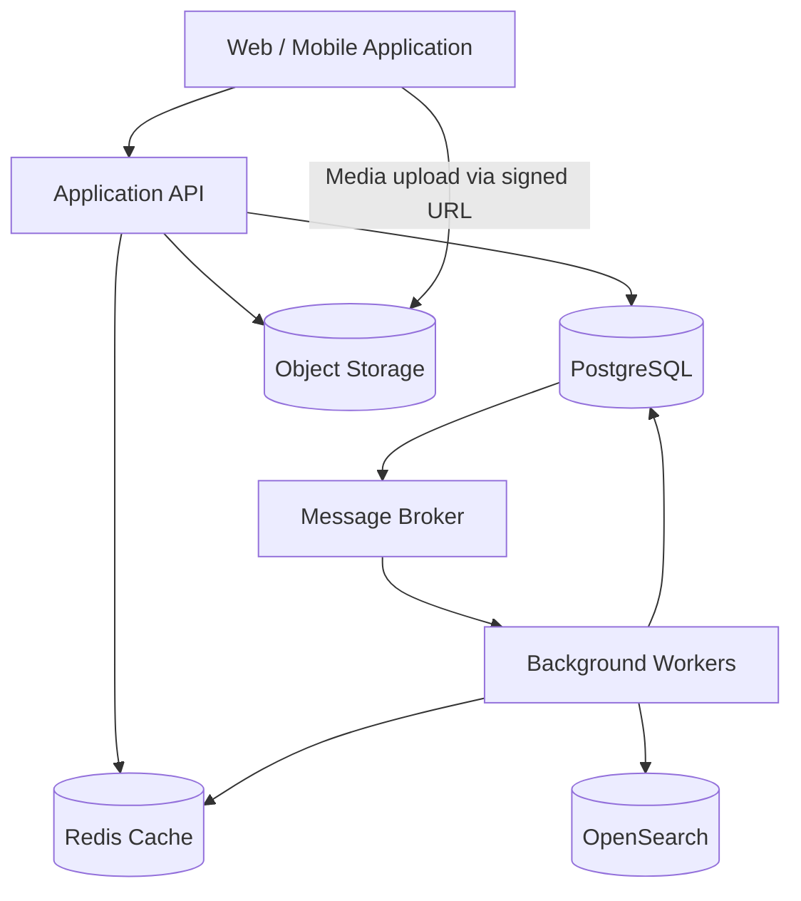
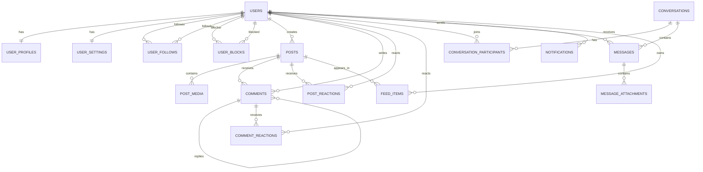
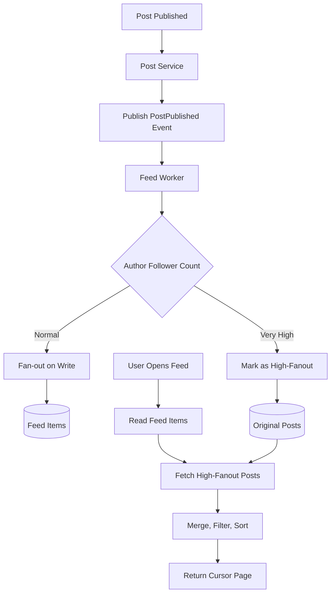

# Proposal Desain Database dan Optimasi — Social Media Platform

- **Jenis Dokumen:** Database Design & Optimization
- **Database Utama:** PostgreSQL
- **Pendukung:** Redis, Object Storage, Kafka, OpenSearch
- **Versi:** 1.0

---

## Daftar Isi

1. [Ringkasan Eksekutif](#1-ringkasan-eksekutif)
2. [Ruang Lingkup dan Asumsi](#2-ruang-lingkup-dan-asumsi)
3. [Arsitektur Data](#3-arsitektur-data)
4. [Prinsip Desain Database](#4-prinsip-desain-database)
5. [Desain Skema dan Relasi](#5-desain-skema-dan-relasi)
6. [DDL PostgreSQL](#6-ddl-postgresql)
7. [Strategi Indexing](#7-strategi-indexing)
8. [Query SQL Utama](#8-query-sql-utama)
9. [Desain Feed Generation](#9-desain-feed-generation)
10. [Desain Private Messaging](#10-desain-private-messaging)
11. [Strategi Caching](#11-strategi-caching)
12. [Optimasi dan Skalabilitas](#12-optimasi-dan-skalabilitas)
13. [Integritas, Konsistensi, dan Concurrency](#13-integritas-konsistensi-dan-concurrency)
14. [Keamanan dan Privasi](#14-keamanan-dan-privasi)
15. [Monitoring dan Pengujian](#15-monitoring-dan-pengujian)
16. [Keputusan Arsitektur dan Trade-off](#16-keputusan-arsitektur-dan-trade-off)
17. [Kesimpulan](#17-kesimpulan)
- [Lampiran A — Checklist Sebelum Implementasi](#lampiran-a--checklist-sebelum-implementasi)
- [Lampiran B — Referensi](#lampiran-b--referensi)

---

## 1. Ringkasan Eksekutif

Dokumen ini mengusulkan desain database untuk platform media sosial yang mendukung profil pengguna, hubungan follower/following, konten multimedia, komentar, reactions, pesan privat, activity feed, dan notifikasi.

**PostgreSQL** dipilih sebagai sumber data utama (*source of truth*) karena menyediakan transaksi ACID, constraint relasional, indexing yang beragam, partitioning, serta kemampuan query yang kuat. **Redis** digunakan untuk cache dan read model berlatensi rendah. File multimedia disimpan di **Object Storage**, sedangkan PostgreSQL hanya menyimpan metadata dan referensi file.

Untuk kebutuhan feed, desain menggunakan pendekatan **hybrid fan-out**: *fan-out on write* untuk akun dengan aktivitas normal dan *fan-out on read* untuk akun dengan jumlah follower sangat besar. Pendekatan ini menghindari biaya fan-out yang tidak proporsional untuk akun berpengikut besar.

Tujuan desain:

- Menjaga integritas dan konsistensi data.
- Mendukung query relasional yang efisien.
- Mengoptimalkan query yang sering dipakai.
- Menangani pertumbuhan data dan write throughput.
- Memisahkan data transaksional dari file multimedia dan read model.
- Menyediakan strategi cache dan pagination yang sesuai.

---

## 2. Ruang Lingkup dan Asumsi

### 2.1 Fitur yang Dicakup

| Domain | Fitur |
| :--- | :--- |
| **User** | Profil, pengaturan akun, followers, following, block |
| **Content** | Post teks, gambar, video, visibility |
| **Interaction** | Komentar, reactions |
| **Messaging** | Conversation, participant, pesan, attachment |
| **Activity** | Feed, notifikasi |
| **Platform** | Cache, indexing, pagination, partitioning |

### 2.2 Asumsi Desain

| Parameter | Asumsi |
| :--- | :--- |
| **Database Utama** | PostgreSQL |
| **Cache** | Redis |
| **Event Streaming** | Kafka atau message broker setara |
| **Media Storage** | S3-compatible Object Storage / GCS |
| **Search** | OpenSearch, bila full-text/search lintas entitas dibutuhkan |
| **ID** | UUID (direkomendasikan UUIDv7 untuk locality index B-Tree yang lebih baik) |
| **Timestamp** | Disimpan dalam UTC menggunakan `TIMESTAMPTZ` |
| **Pagination** | Cursor / keyset pagination untuk dataset besar |
| **Feed** | Hybrid fan-out |
| **Deployment** | Dapat dimulai pada managed PostgreSQL dan berkembang sesuai beban |

> **Catatan:** Tidak ada angka kapasitas yang diasumsikan sebagai fakta. Jumlah pengguna, rasio read/write, jumlah follower, ukuran media, dan pola trafik perlu divalidasi melalui workload model serta load testing.

---

## 3. Arsitektur Data

### 3.1 Logical Data Architecture



PostgreSQL menjadi *source of truth* untuk data bisnis. Redis, OpenSearch, dan feed projection merupakan *read-optimized storage* yang dapat dibangun ulang dari data utama dan event yang tersedia.

### 3.2 Domain dan Tabel

| Domain | Tabel |
| :--- | :--- |
| **User** | `users`, `user_profiles`, `user_settings` |
| **Relationship** | `user_follows`, `user_blocks` |
| **Content** | `posts`, `post_media` |
| **Interaction** | `comments`, `post_reactions`, `comment_reactions` |
| **Messaging** | `conversations`, `conversation_participants`, `messages`, `message_attachments` |
| **Feed** | `feed_items` |
| **Notification** | `notifications` |

---

## 4. Prinsip Desain Database

### 4.1 Normalisasi

Skema transaksional dirancang dengan prinsip normalisasi, umumnya hingga **Third Normal Form (3NF)**, untuk mengurangi redundansi dan menjaga konsistensi.

Contoh:

- Informasi profil dipisahkan dari autentikasi pengguna.
- Media disimpan pada tabel terpisah dari post.
- Komentar dan reactions memiliki tabel sendiri.
- Relasi follower/following disimpan sebagai tabel junction.
- Participant conversation dipisahkan dari conversation.
- Jumlah followers, likes, dan comments tidak dijadikan data utama yang harus selalu dihitung ulang dari tabel transaksi pada setiap request.

Counter yang sering dibaca dapat disimpan sebagai projection/cache terdenormalisasi, dengan mekanisme rekonsiliasi terhadap data sumber.

### 4.2 Primary Key dan Foreign Key

- Gunakan `UUID` sebagai identifier lintas layanan atau entitas.
- Foreign key diterapkan untuk relasi di dalam database yang sama.
- Relasi ke object storage menggunakan `object_key`, bukan foreign key.
- Hindari foreign key lintas database atau lintas service.
- Tentukan kebijakan `ON DELETE` secara eksplisit. Untuk data sosial yang membutuhkan audit atau pemulihan, soft delete dapat lebih sesuai daripada cascade delete.

### 4.3 Timestamp

Gunakan `TIMESTAMPTZ` dan simpan waktu dalam UTC. Konversi ke timezone pengguna dilakukan pada layer aplikasi.

### 4.4 Penghapusan Data

Gunakan `deleted_at` hanya pada entitas yang membutuhkan soft delete (`posts`, `comments`, `messages`). Jangan menerapkan soft delete secara otomatis pada seluruh tabel karena dapat memengaruhi unique constraint, query, dan kebutuhan retensi.

---

## 5. Desain Skema dan Relasi

### 5.1 Users dan Profiles

- `users` menyimpan identitas dasar dan status akun.
- `user_profiles` menyimpan informasi profil yang dapat berubah lebih sering, seperti nama tampilan dan bio.
- `user_settings` menyimpan preferensi privasi dan notifikasi.

### 5.2 Followers dan Following

Relasi follower/following adalah *many-to-many* terhadap tabel `users`. Satu baris `user_follows` menyatakan bahwa `follower_id` mengikuti `following_id`.

Contoh:
- `follower_id = A`
- `following_id = B`
- Artinya **A mengikuti B**.

Gunakan primary key gabungan `(follower_id, following_id)` untuk mencegah duplikasi relasi. Tambahkan index arah urutan waktu baik untuk daftar *following* `(follower_id, created_at DESC, following_id DESC)` maupun daftar *followers* `(following_id, created_at DESC, follower_id DESC)`.

### 5.3 Posts dan Media

Satu user dapat membuat banyak post. Satu post dapat memiliki banyak media.

Database menyimpan:
- `object_key` atau URL hasil resolusi media,
- `media_type` (`IMAGE`, `VIDEO`, `AUDIO`),
- urutan media (`position`),
- ukuran file (`file_size_bytes`),
- metadata teknis yang diperlukan (`width`, `height`, `duration_ms`).

File binary tidak disimpan di PostgreSQL.

### 5.4 Comments dan Reactions

Komentar dapat mendukung reply melalui `parent_comment_id`. Reactions post dan comment dipisah agar foreign key tetap eksplisit dan integritas relasional dapat dijaga.

Untuk model satu reaction aktif per user per post, gunakan primary/unique constraint `(post_id, user_id)`. Jika produk mengizinkan reaction history, desain perlu memisahkan current state dan event history.

### 5.5 Private Messaging

Satu conversation memiliki banyak participant dan banyak message.

- `conversation_participants` menyimpan status keanggotaan, waktu bergabung, dan penanda pesan terakhir yang dibaca (`last_read_message_id` / `last_read_at`).
- `messages` menyimpan pesan dan sender.
- `message_attachments` disimpan terpisah dan file berada di object storage.

Untuk grup, gunakan conversation dengan lebih dari dua participant. Model ini juga mendukung direct message dengan dua participant menggunakan `direct_pair_key`.

### 5.6 ERD



---

## 6. DDL PostgreSQL

DDL berikut merupakan baseline yang dapat dijalankan dan dikembangkan. Untuk ringkasnya, sebagian constraint operasional dan kolom audit tambahan dapat ditambahkan sesuai kebutuhan produk.

### 6.1 Users

```sql
CREATE TABLE users (
    id UUID PRIMARY KEY,
    username VARCHAR(50) NOT NULL UNIQUE,
    email VARCHAR(255) NOT NULL UNIQUE,
    password_hash TEXT NOT NULL,
    status VARCHAR(20) NOT NULL DEFAULT 'ACTIVE',
    created_at TIMESTAMPTZ NOT NULL DEFAULT NOW(),
    updated_at TIMESTAMPTZ NOT NULL DEFAULT NOW(),

    CONSTRAINT chk_users_status
        CHECK (status IN ('ACTIVE', 'SUSPENDED', 'DEACTIVATED'))
);

CREATE TABLE user_profiles (
    user_id UUID PRIMARY KEY REFERENCES users(id) ON DELETE CASCADE,
    display_name VARCHAR(100),
    bio VARCHAR(500),
    avatar_object_key TEXT,
    website_url TEXT,
    created_at TIMESTAMPTZ NOT NULL DEFAULT NOW(),
    updated_at TIMESTAMPTZ NOT NULL DEFAULT NOW()
);

CREATE TABLE user_settings (
    user_id UUID PRIMARY KEY REFERENCES users(id) ON DELETE CASCADE,
    is_private BOOLEAN NOT NULL DEFAULT FALSE,
    allow_messages_from VARCHAR(20) NOT NULL DEFAULT 'FOLLOWERS',
    notification_enabled BOOLEAN NOT NULL DEFAULT TRUE,
    updated_at TIMESTAMPTZ NOT NULL DEFAULT NOW(),

    CONSTRAINT chk_message_policy
        CHECK (allow_messages_from IN ('EVERYONE', 'FOLLOWERS', 'NOBODY'))
);
```

### 6.2 Followers dan Blocks

```sql
CREATE TABLE user_follows (
    follower_id UUID NOT NULL REFERENCES users(id) ON DELETE CASCADE,
    following_id UUID NOT NULL REFERENCES users(id) ON DELETE CASCADE,
    created_at TIMESTAMPTZ NOT NULL DEFAULT NOW(),

    PRIMARY KEY (follower_id, following_id),
    CONSTRAINT chk_no_self_follow
        CHECK (follower_id <> following_id)
);

-- Mendukung query daftar following terurut berdasarkan waktu terbaru (keyset pagination)
CREATE INDEX idx_follows_follower_created
    ON user_follows (follower_id, created_at DESC, following_id DESC);

-- Mendukung query daftar followers terurut berdasarkan waktu terbaru (keyset pagination)
CREATE INDEX idx_follows_following_created
    ON user_follows (following_id, created_at DESC, follower_id DESC);

CREATE TABLE user_blocks (
    blocker_id UUID NOT NULL REFERENCES users(id) ON DELETE CASCADE,
    blocked_id UUID NOT NULL REFERENCES users(id) ON DELETE CASCADE,
    created_at TIMESTAMPTZ NOT NULL DEFAULT NOW(),

    PRIMARY KEY (blocker_id, blocked_id),
    CONSTRAINT chk_no_self_block
        CHECK (blocker_id <> blocked_id)
);

CREATE INDEX idx_blocks_blocked
    ON user_blocks (blocked_id, blocker_id);
```

Primary key `user_follows(follower_id, following_id)` menjaga keunikan relasi dan mendukung pengecekan `EXISTS` secara cepat. Index `idx_follows_follower_created` dan `idx_follows_following_created` mendukung *keyset pagination* berdasarkan urutan waktu follow terbaru untuk kedua arah akses tanpa *in-memory sort*.

### 6.3 Posts dan Media

```sql
CREATE TABLE posts (
    id UUID PRIMARY KEY,
    user_id UUID NOT NULL REFERENCES users(id),
    content TEXT,
    visibility VARCHAR(20) NOT NULL DEFAULT 'PUBLIC',
    status VARCHAR(20) NOT NULL DEFAULT 'PUBLISHED',
    created_at TIMESTAMPTZ NOT NULL DEFAULT NOW(),
    updated_at TIMESTAMPTZ NOT NULL DEFAULT NOW(),
    deleted_at TIMESTAMPTZ,

    CONSTRAINT chk_post_visibility
        CHECK (visibility IN ('PUBLIC', 'FOLLOWERS', 'PRIVATE')),
    CONSTRAINT chk_post_status
        CHECK (status IN ('DRAFT', 'PUBLISHED', 'ARCHIVED'))
);

CREATE INDEX idx_posts_user_published_created
    ON posts (user_id, created_at DESC, id DESC)
    WHERE status = 'PUBLISHED'
      AND deleted_at IS NULL;

CREATE INDEX idx_posts_public_created
    ON posts (created_at DESC, id DESC)
    WHERE visibility = 'PUBLIC'
      AND status = 'PUBLISHED'
      AND deleted_at IS NULL;

CREATE TABLE post_media (
    id UUID PRIMARY KEY,
    post_id UUID NOT NULL REFERENCES posts(id) ON DELETE CASCADE,
    object_key TEXT NOT NULL,
    media_type VARCHAR(20) NOT NULL,
    mime_type VARCHAR(100),
    file_size_bytes BIGINT,
    width INTEGER,
    height INTEGER,
    duration_ms BIGINT,
    position SMALLINT NOT NULL DEFAULT 0,
    created_at TIMESTAMPTZ NOT NULL DEFAULT NOW(),

    CONSTRAINT chk_media_type
        CHECK (media_type IN ('IMAGE', 'VIDEO', 'AUDIO'))
);

CREATE INDEX idx_post_media_post_position
    ON post_media (post_id, position);
```

### 6.4 Comments

```sql
CREATE TABLE comments (
    id UUID PRIMARY KEY,
    post_id UUID NOT NULL REFERENCES posts(id),
    user_id UUID NOT NULL REFERENCES users(id),
    parent_comment_id UUID REFERENCES comments(id),
    content TEXT NOT NULL,
    created_at TIMESTAMPTZ NOT NULL DEFAULT NOW(),
    updated_at TIMESTAMPTZ NOT NULL DEFAULT NOW(),
    deleted_at TIMESTAMPTZ
);

-- Partial index khusus top-level comments agar tidak memindai baris reply
CREATE INDEX idx_comments_post_top_level_created
    ON comments (post_id, created_at DESC, id DESC)
    WHERE parent_comment_id IS NULL
      AND deleted_at IS NULL;

-- Partial index khusus replies pada suatu parent comment
CREATE INDEX idx_comments_parent_created
    ON comments (parent_comment_id, created_at ASC, id ASC)
    WHERE parent_comment_id IS NOT NULL
      AND deleted_at IS NULL;
```

Jika reply bertingkat sangat dalam diperbolehkan, tentukan batas kedalaman atau gunakan model tambahan seperti *materialized path*. Untuk kebutuhan umum, *parent-child* dengan batas kedalaman yang jelas lebih sederhana.

### 6.5 Reactions

Contoh ini mengasumsikan satu reaction aktif per user untuk setiap post dan satu reaction aktif per user untuk setiap comment.

```sql
CREATE TABLE post_reactions (
    post_id UUID NOT NULL REFERENCES posts(id) ON DELETE CASCADE,
    user_id UUID NOT NULL REFERENCES users(id),
    reaction_type VARCHAR(20) NOT NULL,
    created_at TIMESTAMPTZ NOT NULL DEFAULT NOW(),

    PRIMARY KEY (post_id, user_id)
);

CREATE INDEX idx_post_reactions_user
    ON post_reactions (user_id, created_at DESC);

CREATE TABLE comment_reactions (
    comment_id UUID NOT NULL REFERENCES comments(id) ON DELETE CASCADE,
    user_id UUID NOT NULL REFERENCES users(id),
    reaction_type VARCHAR(20) NOT NULL,
    created_at TIMESTAMPTZ NOT NULL DEFAULT NOW(),

    PRIMARY KEY (comment_id, user_id)
);

CREATE INDEX idx_comment_reactions_user
    ON comment_reactions (user_id, created_at DESC);
```

Jika produk mengizinkan banyak jenis reaction dari user yang sama pada satu post, ubah unique key sesuai aturan produk, misalnya `(post_id, user_id, reaction_type)`.

### 6.6 Conversations dan Participants

```sql
CREATE TABLE conversations (
    id UUID PRIMARY KEY,
    conversation_type VARCHAR(20) NOT NULL DEFAULT 'DIRECT',
    direct_pair_key VARCHAR(100),
    created_by UUID NOT NULL REFERENCES users(id),
    created_at TIMESTAMPTZ NOT NULL DEFAULT NOW(),
    updated_at TIMESTAMPTZ NOT NULL DEFAULT NOW(),

    CONSTRAINT chk_conversation_type
        CHECK (conversation_type IN ('DIRECT', 'GROUP'))
);

-- Menjamin hanya ada satu conversation DIRECT aktif untuk pasangan user yang sama
CREATE UNIQUE INDEX uq_conversations_direct_pair
    ON conversations (direct_pair_key)
    WHERE conversation_type = 'DIRECT'
      AND direct_pair_key IS NOT NULL;

CREATE TABLE conversation_participants (
    conversation_id UUID NOT NULL REFERENCES conversations(id) ON DELETE CASCADE,
    user_id UUID NOT NULL REFERENCES users(id),
    joined_at TIMESTAMPTZ NOT NULL DEFAULT NOW(),
    last_read_message_id UUID,
    last_read_at TIMESTAMPTZ,
    muted_until TIMESTAMPTZ,
    left_at TIMESTAMPTZ,

    PRIMARY KEY (conversation_id, user_id)
);

CREATE INDEX idx_conversation_participant_user
    ON conversation_participants (user_id, joined_at DESC)
    WHERE left_at IS NULL;
```

Untuk direct conversation, aplikasi membentuk `direct_pair_key` secara kanonik (misalnya `LEAST(user_a, user_b) || ':' || GREATEST(user_a, user_b)`) yang dilindungi oleh unique partial index `uq_conversations_direct_pair`.

### 6.7 Messages dan Attachments

```sql
CREATE TABLE messages (
    id UUID PRIMARY KEY,
    conversation_id UUID NOT NULL REFERENCES conversations(id),
    sender_id UUID NOT NULL REFERENCES users(id),
    body TEXT,
    message_type VARCHAR(20) NOT NULL DEFAULT 'TEXT',
    created_at TIMESTAMPTZ NOT NULL DEFAULT NOW(),
    edited_at TIMESTAMPTZ,
    deleted_at TIMESTAMPTZ,

    CONSTRAINT chk_message_type
        CHECK (message_type IN ('TEXT', 'MEDIA', 'SYSTEM'))
);

CREATE INDEX idx_messages_conversation_created
    ON messages (conversation_id, created_at DESC, id DESC)
    WHERE deleted_at IS NULL;

CREATE TABLE message_attachments (
    id UUID PRIMARY KEY,
    message_id UUID NOT NULL REFERENCES messages(id) ON DELETE CASCADE,
    object_key TEXT NOT NULL,
    media_type VARCHAR(20) NOT NULL,
    file_size_bytes BIGINT,
    created_at TIMESTAMPTZ NOT NULL DEFAULT NOW()
);

CREATE INDEX idx_message_attachments_message
    ON message_attachments (message_id);
```

Validasi bahwa `sender_id` merupakan participant aktif pada conversation dapat diperkuat dengan composite foreign key ke `conversation_participants(conversation_id, user_id)` atau divalidasi di dalam transaksi aplikasi.

### 6.8 Feed Items

`feed_items` adalah read model/projection untuk mempercepat pembacaan timeline. Tabel ini bukan sumber kebenaran post atau follow relationship.

```sql
CREATE TABLE feed_items (
    user_id UUID NOT NULL REFERENCES users(id) ON DELETE CASCADE,
    post_id UUID NOT NULL REFERENCES posts(id) ON DELETE CASCADE,
    author_id UUID NOT NULL REFERENCES users(id) ON DELETE CASCADE,
    created_at TIMESTAMPTZ NOT NULL,

    PRIMARY KEY (user_id, post_id)
);

CREATE INDEX idx_feed_user_created
    ON feed_items (user_id, created_at DESC, post_id DESC);
```

### 6.9 Notifications

```sql
CREATE TABLE notifications (
    id UUID PRIMARY KEY,
    recipient_id UUID NOT NULL REFERENCES users(id) ON DELETE CASCADE,
    actor_id UUID REFERENCES users(id) ON DELETE SET NULL,
    notification_type VARCHAR(30) NOT NULL,
    entity_type VARCHAR(30),
    entity_id UUID,
    payload JSONB NOT NULL DEFAULT '{}'::JSONB,
    read_at TIMESTAMPTZ,
    created_at TIMESTAMPTZ NOT NULL DEFAULT NOW()
);

CREATE INDEX idx_notifications_recipient_created
    ON notifications (recipient_id, created_at DESC, id DESC);

CREATE INDEX idx_notifications_unread
    ON notifications (recipient_id, created_at DESC, id DESC)
    WHERE read_at IS NULL;
```

`entity_type` dan `entity_id` merupakan polymorphic reference sehingga tidak memiliki foreign key langsung. Jika integritas referensial wajib ditegakkan, gunakan tabel referensi spesifik atau model notification target yang memiliki foreign key eksplisit.

---

## 7. Strategi Indexing

Index harus mengikuti pola query yang benar-benar digunakan. Setiap index mempercepat pola baca tertentu tetapi menambah biaya storage dan write.

### 7.1 Index Utama

| Tabel | Index | Query yang Didukung |
| :--- | :--- | :--- |
| `users` | `UNIQUE (username)` | Pencarian username |
| `users` | `UNIQUE (email)` | Login dan lookup email |
| `user_follows` | `PK (follower_id, following_id)` | Cek relasi follow (`EXISTS`) dan unfollow |
| `user_follows` | `(follower_id, created_at DESC, following_id DESC)` | Daftar following terurut waktu |
| `user_follows` | `(following_id, created_at DESC, follower_id DESC)` | Daftar followers terurut waktu |
| `posts` | `(user_id, created_at DESC, id DESC) WHERE status = 'PUBLISHED' AND deleted_at IS NULL` | Post aktif milik user |
| `posts` | `(created_at DESC, id DESC) WHERE visibility = 'PUBLIC' AND status = 'PUBLISHED' AND deleted_at IS NULL` | Feed publik |
| `comments` | `(post_id, created_at DESC, id DESC) WHERE parent_comment_id IS NULL AND deleted_at IS NULL` | Komentar top-level terbaru |
| `comments` | `(parent_comment_id, created_at ASC, id ASC) WHERE parent_comment_id IS NOT NULL AND deleted_at IS NULL` | Balasan komentar (replies) |
| `post_reactions` | `PK (post_id, user_id)` | Cek reaction user pada post & agregasi per post |
| `messages` | `(conversation_id, created_at DESC, id DESC) WHERE deleted_at IS NULL` | Riwayat pesan per conversation |
| `feed_items` | `(user_id, created_at DESC, post_id DESC)` | Timeline user (keyset pagination) |
| `notifications` | `(recipient_id, created_at DESC, id DESC) WHERE read_at IS NULL` | Daftar notifikasi belum dibaca |

### 7.2 Prinsip Composite Index

Urutan kolom composite index sangat menentukan efisiensi index scan. Letakkan kolom equality filter di bagian awal, lalu kolom sort/range sesuai pola query.

Contoh:

```sql
CREATE INDEX idx_messages_conversation_created
    ON messages (conversation_id, created_at DESC, id DESC)
    WHERE deleted_at IS NULL;
```

Index ini cocok untuk query yang memfilter satu `conversation_id` lalu mengambil pesan terbaru. Index tersebut tidak otomatis optimal untuk query global berdasarkan `created_at` tanpa filter `conversation_id`.

### 7.3 Partial Index

Partial index cocok jika query sering mengakses subset data yang stabil.

Contoh:

```sql
CREATE INDEX idx_posts_user_published_created
    ON posts (user_id, created_at DESC, id DESC)
    WHERE status = 'PUBLISHED'
      AND deleted_at IS NULL;
```

Query perlu menyertakan predicate `WHERE` yang kompatibel agar query planner PostgreSQL dapat menggunakan partial index tersebut.

### 7.4 Hindari Over-Indexing

Sebelum menambahkan index:

1. Identifikasi query yang lambat.
2. Jalankan `EXPLAIN (ANALYZE, BUFFERS)`.
3. Periksa row estimate dan actual rows.
4. Periksa sequential scan, bitmap scan, dan index scan.
5. Evaluasi write overhead dan ukuran index.
6. Uji kembali dengan data yang representatif.

---

## 8. Query SQL Utama

Contoh query berikut menggunakan sintaks PostgreSQL.

### 8.1 Mengambil Daftar Following

```sql
SELECT
    u.id,
    u.username,
    p.display_name,
    p.avatar_object_key,
    f.created_at AS followed_at
FROM user_follows f
JOIN users u ON u.id = f.following_id
LEFT JOIN user_profiles p ON p.user_id = u.id
WHERE f.follower_id = :user_id
ORDER BY f.created_at DESC, f.following_id DESC
LIMIT :limit;
```

Index utama: `idx_follows_follower_created`.

### 8.2 Mengambil Daftar Followers

```sql
SELECT
    u.id,
    u.username,
    p.display_name,
    p.avatar_object_key,
    f.created_at AS followed_at
FROM user_follows f
JOIN users u ON u.id = f.follower_id
LEFT JOIN user_profiles p ON p.user_id = u.id
WHERE f.following_id = :user_id
ORDER BY f.created_at DESC, f.follower_id DESC
LIMIT :limit;
```

Index utama: `idx_follows_following_created`.

### 8.3 Cek Apakah User Mengikuti User Lain

```sql
SELECT EXISTS (
    SELECT 1
    FROM user_follows
    WHERE follower_id = :current_user_id
      AND following_id = :target_user_id
) AS is_following;
```

Primary key gabungan `(follower_id, following_id)` melayani lookup ini secara langsung (*index-only scan*).

### 8.4 Mutual Followers

Mencari akun yang diikuti oleh kedua user:

```sql
SELECT a.following_id AS mutual_user_id
FROM user_follows a
JOIN user_follows b
  ON b.following_id = a.following_id
WHERE a.follower_id = :user_a
  AND b.follower_id = :user_b
ORDER BY a.following_id
LIMIT :limit;
```

Untuk pola query ini, primary key `(follower_id, following_id)` membantu kedua sisi lookup secara terurut melalui *merge join*.

### 8.5 Mengambil Post Milik User

Halaman pertama:

```sql
SELECT
    p.id,
    p.content,
    p.visibility,
    p.created_at
FROM posts p
WHERE p.user_id = :user_id
  AND p.status = 'PUBLISHED'
  AND p.deleted_at IS NULL
ORDER BY p.created_at DESC, p.id DESC
LIMIT :limit;
```

Gunakan *keyset pagination* untuk halaman selanjutnya:

```sql
SELECT
    id,
    content,
    visibility,
    created_at
FROM posts
WHERE user_id = :user_id
  AND status = 'PUBLISHED'
  AND deleted_at IS NULL
  AND (created_at, id) < (:cursor_created_at, :cursor_id)
ORDER BY created_at DESC, id DESC
LIMIT :limit;
```

### 8.6 Mengambil Komentar Post

```sql
SELECT
    c.id,
    c.user_id,
    u.username,
    c.content,
    c.created_at
FROM comments c
JOIN users u ON u.id = c.user_id
WHERE c.post_id = :post_id
  AND c.parent_comment_id IS NULL
  AND c.deleted_at IS NULL
ORDER BY c.created_at DESC, c.id DESC
LIMIT :limit;
```

Index utama: `idx_comments_post_top_level_created`.

### 8.7 Menghitung Reactions

```sql
SELECT
    reaction_type,
    COUNT(*) AS total
FROM post_reactions
WHERE post_id = :post_id
GROUP BY reaction_type;
```

Untuk post dengan interaksi sangat tinggi, hasil agregat dapat disimpan pada counter projection/cache yang diperbarui secara asynchronous. Counter tersebut harus memiliki strategi rekonsiliasi.

### 8.8 Mengambil Riwayat Pesan

```sql
SELECT
    id,
    sender_id,
    body,
    message_type,
    created_at
FROM messages
WHERE conversation_id = :conversation_id
  AND deleted_at IS NULL
  AND (created_at, id) < (:cursor_created_at, :cursor_id)
ORDER BY created_at DESC, id DESC
LIMIT :limit;
```

Gunakan cursor pagination, bukan `OFFSET` besar, untuk percakapan dengan riwayat panjang.

### 8.9 Mengambil Notifikasi Belum Dibaca

```sql
SELECT
    id,
    actor_id,
    notification_type,
    entity_type,
    entity_id,
    payload,
    created_at
FROM notifications
WHERE recipient_id = :user_id
  AND read_at IS NULL
ORDER BY created_at DESC, id DESC
LIMIT :limit;
```

Partial index `idx_notifications_unread` mendukung query ini.

### 8.10 Menghitung Unread Messages

Untuk desain sederhana, unread count dapat dihitung berdasarkan `last_read_at`:

```sql
SELECT
    m.conversation_id,
    COUNT(*) AS unread_count
FROM messages m
JOIN conversation_participants cp
  ON cp.conversation_id = m.conversation_id
WHERE cp.user_id = :user_id
  AND cp.left_at IS NULL
  AND m.deleted_at IS NULL
  AND m.sender_id <> :user_id
  AND (cp.last_read_at IS NULL OR m.created_at > cp.last_read_at)
GROUP BY m.conversation_id;
```

Untuk skala besar, jangan menjalankan agregasi seluruh pesan setiap kali membuka inbox. Gunakan unread counter projection yang diperbarui saat pesan masuk dan read cursor bergerak. Counter perlu direkonsiliasi agar tetap akurat.

---

## 9. Desain Feed Generation

Feed merupakan salah satu query paling mahal pada platform sosial karena menggabungkan aktivitas banyak akun yang diikuti seorang pengguna. Terdapat tiga pendekatan utama:

### 9.1 Fan-out on Read

Saat pengguna membuka feed:

1. Ambil daftar akun yang diikuti.
2. Ambil post terbaru dari akun tersebut.
3. Gabungkan dan urutkan.
4. Kembalikan halaman feed.

Contoh query konseptual:

```sql
SELECT
    p.id,
    p.user_id,
    p.content,
    p.created_at
FROM user_follows f
JOIN posts p ON p.user_id = f.following_id
WHERE f.follower_id = :user_id
  AND p.status = 'PUBLISHED'
  AND p.visibility IN ('PUBLIC', 'FOLLOWERS')
  AND p.deleted_at IS NULL
ORDER BY p.created_at DESC, p.id DESC
LIMIT :limit;
```

**Kelebihan:**
- Tidak membutuhkan fan-out saat post dibuat.
- Tidak menyimpan salinan post untuk setiap follower.
- Lebih sederhana untuk akun dengan sedikit aktivitas.

**Kekurangan:**
- Biaya query bertambah seiring jumlah akun yang diikuti dan aktivitas mereka.
- Membaca feed dapat menjadi mahal untuk pengguna yang mengikuti banyak akun.

Query produksi juga harus menerapkan aturan privasi, block, mute, dan kelayakan konten secara konsisten.

### 9.2 Fan-out on Write

Saat sebuah post dibuat:

1. Simpan post ke tabel `posts`.
2. Terbitkan event `PostPublished`.
3. Worker mengambil followers pembuat post.
4. Worker memasukkan referensi post ke `feed_items` milik followers.
5. Feed dibaca dari `feed_items`.

Contoh insert idempotent:

```sql
INSERT INTO feed_items (
    user_id,
    post_id,
    author_id,
    created_at
)
SELECT
    follower_id,
    :post_id,
    :author_id,
    :post_created_at
FROM user_follows
WHERE following_id = :author_id
ON CONFLICT (user_id, post_id) DO NOTHING;
```

Untuk skala besar, proses ini harus dibagi menjadi batch dan dijalankan asynchronous. Satu transaksi besar untuk seluruh follower tidak direkomendasikan.

**Kelebihan:**
- Pembacaan feed cepat.
- Query feed tidak perlu menggabungkan seluruh relasi follow setiap kali.
- Cocok untuk akun dengan jumlah follower normal.

**Kekurangan:**
- Biaya write bertambah sesuai jumlah followers.
- Post dari akun dengan follower sangat banyak dapat menghasilkan *write amplification*.
- Feed projection dapat tertinggal dari post sumber.

### 9.3 Hybrid Fan-out

Rekomendasi desain adalah **hybrid fan-out**:

- **Akun normal:** *fan-out on write*.
- **Akun dengan follower sangat besar (celebrity / high-fanout):** *fan-out on read*.
- Feed read menggabungkan feed precomputed (`feed_items`) dengan post terbaru dari akun high-fanout yang diikuti user.
- Threshold ditentukan berdasarkan pengukuran biaya fan-out dan kebutuhan latency, bukan angka universal.

#### Diagram Hybrid Feed



### 9.4 Query Membaca Feed Projection

```sql
SELECT
    fi.post_id,
    fi.author_id,
    fi.created_at,
    p.content
FROM feed_items fi
JOIN posts p ON p.id = fi.post_id
WHERE fi.user_id = :user_id
  AND (fi.created_at, fi.post_id) < (:cursor_created_at, :cursor_post_id)
  AND p.status = 'PUBLISHED'
  AND p.deleted_at IS NULL
  AND NOT EXISTS (
      SELECT 1
      FROM user_blocks ub
      WHERE (ub.blocker_id = :user_id AND ub.blocked_id = fi.author_id)
         OR (ub.blocker_id = fi.author_id AND ub.blocked_id = :user_id)
  )
ORDER BY fi.created_at DESC, fi.post_id DESC
LIMIT :limit;
```

Sebelum dikembalikan, feed harus menerapkan aturan visibility, block, mute, dan status akun. Untuk efisiensi, sebagian filter diterapkan saat membangun projection (dan menghapus `feed_items` saat terjadi block/unfollow), ditambah validasi pada *read path*.

### 9.5 Konsistensi Feed

Feed adalah read model asynchronous. Karena itu, post baru mungkin tidak langsung muncul pada seluruh follower.

Mitigasi:

- Transactional Outbox pada transaksi pembuatan post.
- Worker yang idempotent.
- Batch fan-out.
- Retry dan dead-letter handling.
- Monitoring event lag.
- Rebuild/replay feed projection.
- Filtering berdasarkan data sumber untuk perubahan privasi penting.

---

## 10. Desain Private Messaging

### 10.1 Model Conversation

- `conversations` merepresentasikan ruang percakapan.
- `conversation_participants` menghubungkan user ke conversation.
- `messages` menyimpan pesan berdasarkan conversation dan sender.

Untuk direct message, sistem menjamin satu conversation aktif untuk pasangan user yang sama melalui kolom `direct_pair_key` (dibentuk dari dua UUID terurut, misalnya `LEAST(u1, u2) || ':' || GREATEST(u1, u2)`) dengan unique partial index `uq_conversations_direct_pair`. Pembuatan conversation menggunakan transaksi dengan `ON CONFLICT` agar bebas dari *race condition* ketika dua user mengirim pesan pertama secara bersamaan.

### 10.2 Membaca Pesan

Gunakan *keyset pagination* dengan `(created_at, id)` sebagai cursor. Hindari `OFFSET` besar karena database harus melewati baris yang tidak dikembalikan.

### 10.3 Read Cursor

`last_read_message_id` dan `last_read_at` menyimpan posisi baca setiap participant. Update read cursor harus bersifat monotonik (`WHERE last_read_at IS NULL OR last_read_at < :new_read_at`) agar request yang datang terlambat tidak memundurkan posisi baca.

### 10.4 Real-time Delivery

Database tidak perlu menjadi mekanisme push real-time. Gunakan WebSocket atau layanan real-time untuk delivery ke client. Pesan tetap dipersist ke database terlebih dahulu sebelum dikirim sebagai pesan terkirim.

Kafka atau message broker digunakan untuk mendistribusikan event pesan ke notification/delivery workers. Redis Pub/Sub dapat digunakan untuk sinyal real-time berumur pendek (*ephemeral*), tetapi bukan sebagai penyimpanan pesan durable.

---

## 11. Strategi Caching

### 11.1 Data yang Cocok Di-cache

| Data | Contoh Cache Key | TTL Awal | Catatan |
| :--- | :--- | :---: | :--- |
| **User Profile** | `profile:{user_id}` | 5–15 menit | Invalidate saat profil berubah |
| **User Settings** | `settings:{user_id}` | 5 menit | Data privasi harus cepat terbarui |
| **User Feed** | `feed:{user_id}:{cursor}` | 30–120 detik | Invalidate/refresh secara selektif |
| **Post Detail** | `post:{post_id}` | 1–5 menit | Invalidate saat post berubah |
| **Follow Status** | `follow:{follower}:{following}` | 1–5 menit | Invalidate saat follow/unfollow |
| **Reaction Summary** | `post_reactions:{post_id}` | 30–60 detik | Projection / counter |
| **Unread Count** | `unread:{user_id}` | Singkat | Update secara event-driven |

TTL hanyalah titik awal. Nilai aktual ditentukan dari toleransi *stale data*, tingkat perubahan, dan *cache hit ratio*.

### 11.2 Cache Invalidation

Perubahan data utama menerbitkan event melalui outbox. Worker memperbarui atau menghapus cache terkait:

- `UserProfileUpdated` → invalidate profile cache.
- `PostUpdated` → invalidate post cache.
- `PostDeleted` → invalidate post dan feed projection terkait.
- `UserFollowed` → update follow cache dan feed relationship.
- `MessageCreated` → update unread projection.

Jangan mengandalkan invalidasi cache sebagai satu-satunya kontrol privasi. Endpoint tetap harus melakukan otorisasi berdasarkan data yang dapat dipercaya.

### 11.3 Cache Stampede

Untuk key yang populer:

- Gunakan TTL dengan *jitter*.
- Gunakan *request coalescing* / *single-flight*.
- Pertimbangkan *stale-while-revalidate* untuk data yang boleh sedikit tertinggal.
- Batasi concurrency saat terjadi cache miss.
- Hindari menghapus banyak key populer secara serentak.

### 11.4 Cache Aside

Alur umum:

1. Aplikasi membaca Redis.
2. Jika *cache hit*, kembalikan data.
3. Jika *cache miss*, baca PostgreSQL.
4. Simpan hasil ke Redis dengan TTL.
5. Saat data berubah, invalidate atau perbarui cache melalui event.

---

## 12. Optimasi dan Skalabilitas

### 12.1 Keyset Pagination

Gunakan cursor pagination untuk tabel besar seperti `posts`, `comments`, `messages`, dan `notifications`:

```sql
SELECT id, content, created_at
FROM posts
WHERE user_id = :user_id
  AND status = 'PUBLISHED'
  AND deleted_at IS NULL
  AND (created_at, id) < (:cursor_created_at, :cursor_id)
ORDER BY created_at DESC, id DESC
LIMIT 20;
```

Cursor harus berasal dari baris terakhir halaman sebelumnya. Kombinasi kolom sort harus stabil dan unik.

### 12.2 Connection Pooling

Gunakan connection pooling (misalnya PgBouncer atau pool di layer aplikasi) agar jumlah koneksi aplikasi tidak melampaui kapasitas PostgreSQL. Pool size harus dihitung dari jumlah replica, worker, dan kapasitas database, bukan ditetapkan terlalu besar pada setiap instance.

### 12.3 Read Replica

Read replica dapat membantu workload *read-heavy* seperti profil publik, post lama, dan analytics ringan.

Pertimbangkan *replication lag*. Query yang membutuhkan *read-after-write consistency*, misalnya setelah user membuat post lalu langsung membuka detailnya, sebaiknya diarahkan ke primary atau memakai strategi konsistensi yang eksplisit.

### 12.4 Partitioning

Partitioning bukan langkah pertama untuk semua tabel. Terapkan ketika ukuran, retensi, atau pola query membenarkannya.

Kandidat tabel:
- `messages`, berdasarkan rentang waktu (`created_at`) atau hash `conversation_id`.
- `notifications`, berdasarkan rentang waktu (`created_at`).
- Event/audit tables, berdasarkan rentang waktu.
- Activity history yang terus bertambah.

Contoh partitioning berdasarkan bulan untuk tabel event:

```sql
CREATE TABLE activity_events (
    id UUID NOT NULL,
    user_id UUID NOT NULL,
    event_type VARCHAR(50) NOT NULL,
    payload JSONB NOT NULL DEFAULT '{}'::JSONB,
    created_at TIMESTAMPTZ NOT NULL,
    PRIMARY KEY (created_at, id)
) PARTITION BY RANGE (created_at);

CREATE TABLE activity_events_2026_10
PARTITION OF activity_events
FOR VALUES FROM ('2026-10-01') TO ('2026-11-01');
```

> **Catatan Penting PostgreSQL:** Pada tabel yang di-partition, setiap `PRIMARY KEY` atau `UNIQUE` constraint wajib menyertakan kolom *partition key* (seperti `PRIMARY KEY (created_at, id)` di atas).

### 12.5 Denormalisasi Terkontrol

Denormalisasi dapat digunakan pada read model:
- Feed items (`feed_items`).
- Reaction counters.
- Comment counters.
- Follower/following counters.
- Unread message counters.

Data tersebut harus dianggap sebagai projection/cache, memiliki proses rebuild, dan direkonsiliasi secara berkala terhadap data sumber.

---

## 13. Integritas, Konsistensi, dan Concurrency

### 13.1 Follow / Unfollow

Operasi follow harus bersifat idempotent:

```sql
INSERT INTO user_follows (follower_id, following_id)
VALUES (:follower_id, :following_id)
ON CONFLICT (follower_id, following_id) DO NOTHING;
```

Operasi unfollow:

```sql
DELETE FROM user_follows
WHERE follower_id = :follower_id
  AND following_id = :following_id;
```

Jika akun privat membutuhkan approval, jangan langsung membuat baris di `user_follows`. Gunakan tabel `follow_requests` dengan status yang eksplisit (`PENDING`, `APPROVED`, `REJECTED`).

### 13.2 Reaction

Upsert reaction secara atomik:

```sql
INSERT INTO post_reactions (
    post_id,
    user_id,
    reaction_type
)
VALUES (
    :post_id,
    :user_id,
    :reaction_type
)
ON CONFLICT (post_id, user_id)
DO UPDATE SET
    reaction_type = EXCLUDED.reaction_type,
    created_at = NOW();
```

Primary key `(post_id, user_id)` memastikan hanya ada satu reaction aktif per user per post sesuai asumsi model.

### 13.3 Counter Consistency

Jangan melakukan *read-modify-write* di aplikasi tanpa concurrency control untuk counter populer.

Pilihan:
- Atomic SQL increment/decrement.
- Event-driven counter projection.
- Periodic reconciliation dari tabel sumber.

Untuk post yang sangat populer, satu row counter dapat menjadi *hotspot*. Pertimbangkan *sharded counters* atau agregasi asynchronous jika pengukuran menunjukkan *row lock contention*.

### 13.4 Idempotency Event

Event asynchronous dapat dikirim lebih dari sekali (*at-least-once delivery*). Simpan `event_id` yang sudah diproses pada tabel `processed_events` dengan unique constraint. Perubahan bisnis dan pencatatan event yang telah diproses harus berada dalam satu transaksi database.

---

## 14. Keamanan dan Privasi

- Password disimpan sebagai hash menggunakan algoritma password hashing yang kuat (`Argon2id` atau `bcrypt`), bukan plaintext.
- Terapkan *least privilege* pada database roles.
- Gunakan TLS untuk koneksi aplikasi ke database.
- Enkripsi storage dan backup (*encryption at rest*).
- Batasi akses object storage dengan private bucket dan *signed URL* berumur pendek.
- Validasi hak akses post berdasarkan `visibility`, follow approval, `user_blocks`, dan status akun.
- Pesan privat hanya dapat dibaca oleh participant yang berhak.
- Jangan mencatat isi pesan, token, password, atau data sensitif ke application log.
- Tentukan kebijakan retensi, penghapusan akun, dan penghapusan file media di object storage.
- Audit akses administratif dan operasi sensitif.

---

## 15. Monitoring dan Pengujian

### 15.1 Metrik Database

Pantau metrik berikut:

- Query latency p50, p95, p99.
- Query throughput (QPS / TPS).
- Active dan idle connections.
- Lock wait dan deadlock.
- Cache hit ratio (Redis) dan buffer cache hit ratio (PostgreSQL).
- Disk IOPS dan storage growth.
- Replication lag.
- Table dan index bloat.
- Autovacuum activity.
- Slow query frequency (`pg_stat_statements`).
- Transaction duration.

### 15.2 Metrik Feed dan Messaging

- Feed generation latency.
- Feed worker backlog.
- Fan-out jobs per post.
- High-fanout author processing time.
- Message persistence latency.
- Unread projection lag.
- Notification delivery lag.
- Kafka consumer lag.

### 15.3 Pengujian

| Skenario | Tujuan |
| :--- | :--- |
| **Banyak user follow/unfollow bersamaan** | Validasi unique constraint dan concurrency |
| **Post dengan jutaan follower** | Menguji perilaku hybrid fan-out |
| **Post dengan reaction tinggi** | Menguji write contention dan akurasi counter |
| **Conversation dengan riwayat panjang** | Menguji stabilitas latency keyset pagination |
| **Banyak pesan masuk bersamaan** | Menguji throughput insert |
| **Cache outage** | Menguji ketahanan fallback ke database |
| **Read replica lag** | Menguji konsistensi read-after-write |
| **Feed worker berhenti** | Menguji mekanisme retry dan replay |
| **Penghapusan akun** | Menguji kebijakan privasi, cascade, dan retensi |

Gunakan data uji yang representatif. Dataset kecil sering menghasilkan execution plan yang berbeda dari kondisi produksi.

### 15.4 Analisis Query

Gunakan perintah berikut untuk memverifikasi rencana eksekusi query:

```sql
EXPLAIN (ANALYZE, BUFFERS)
SELECT id, content, created_at
FROM posts
WHERE user_id = :user_id
  AND status = 'PUBLISHED'
  AND deleted_at IS NULL
ORDER BY created_at DESC, id DESC
LIMIT 20;
```

Perhatikan:
- *Estimated rows* dibanding *actual rows*.
- *Shared hit* vs *read blocks*.
- Operasi *Sort* yang tidak menggunakan index (*external merge* / *in-memory sort*).
- *Sequential Scan* pada tabel besar.
- *Nested Loop* yang menghasilkan jumlah iterasi tinggi.
- Total buffer read dan execution time.

Jangan mengoptimalkan berdasarkan satu angka execution time saja. Uji dengan kondisi cache *warm* maupun *cold* serta volume data yang realistis.

---

## 16. Keputusan Arsitektur dan Trade-off

| Keputusan | Manfaat | Trade-off |
| :--- | :--- | :--- |
| **PostgreSQL sebagai Source of Truth** | ACID dan integritas relasional | Perlu perencanaan kapasitas dan manajemen koneksi |
| **Normalized Schema (3NF)** | Mengurangi redundansi dan anomali update | Operasi read tertentu membutuhkan join |
| **Redis Cache** | Latency baca sangat rendah | Membutuhkan cache invalidation dan penanganan stale data |
| **Object Storage untuk Media** | Skalabilitas file tinggi dan biaya lebih efisien | Perlu pengelolaan lifecycle orphan file dan signed URL |
| **Hybrid Feed** | Menyeimbangkan read cost dan write cost | Implementasi merge dan konsistensi lebih kompleks |
| **Feed Projection (`feed_items`)** | Query timeline pengguna sangat cepat | Membutuhkan storage tambahan dan terdapat asynchronous lag |
| **Keyset Pagination** | Performa stabil $O(\text{limit})$ pada data besar | Tidak mendukung lompat langsung ke nomor halaman acak |
| **Partitioning Selektif** | Membantu pengelolaan tabel besar dan retensi data | Operasional dan aturan unique constraint lebih ketat |
| **Denormalized Counters** | Pembacaan counter instan tanpa `COUNT(*)` | Perlu rekonsiliasi berkala dan penanganan hotspot |

---

## 17. Kesimpulan

Desain ini menggunakan **PostgreSQL** sebagai sumber data utama dengan skema relasional yang dinormalisasi untuk menjaga integritas data. **Redis** digunakan untuk cache, **Object Storage** untuk file multimedia, dan **Message Broker** untuk memproses pekerjaan asynchronous.

Relasi follower/following menggunakan junction table dengan composite index untuk kedua arah akses. Konten dan interaksi dipisahkan berdasarkan entitas agar constraint dan query dapat dioptimalkan. Private messaging menggunakan model conversation dan participant yang mendukung baik direct maupun group conversation dengan jaminan keunikan pasangan direct chat.

Feed menggunakan **hybrid fan-out** untuk menyeimbangkan biaya write dan read. Feed projection, counters, dan unread count diperlakukan sebagai read model yang dapat diperbarui serta dibangun ulang dari sumber data.

Optimasi dilakukan berdasarkan query pattern, execution plan (`EXPLAIN (ANALYZE, BUFFERS)`), dan pengukuran beban nyata. Index, cache, partitioning, dan denormalisasi diterapkan secara selektif agar performa meningkat tanpa mengorbankan integritas dan maintainability.

---

## Lampiran A — Checklist Sebelum Implementasi

- [ ] Konfirmasi aturan privasi akun dan post (`PUBLIC`, `FOLLOWERS`, `PRIVATE`).
- [ ] Tentukan apakah follow akun privat memerlukan approval (`follow_requests`).
- [ ] Tentukan aturan block dan dampaknya pada feed serta messaging.
- [ ] Tentukan apakah reaction dibatasi satu per user atau dapat lebih dari satu jenis.
- [ ] Tentukan batas kedalaman komentar/reply.
- [ ] Tentukan mekanisme canonical `direct_pair_key` untuk direct conversation uniqueness.
- [ ] Tentukan kebijakan penghapusan pesan dan akun (GDPR / retensi).
- [ ] Tentukan batas ukuran dan retensi media di Object Storage.
- [ ] Tetapkan kontrak cursor pagination di seluruh endpoint list.
- [ ] Definisikan threshold follower untuk high-fanout accounts pada hybrid feed.
- [ ] Tetapkan SLO dan workload model.
- [ ] Validasi seluruh query utama menggunakan data uji berjumlah realistis.

---

## Lampiran B — Referensi

- **PostgreSQL Documentation**: https://www.postgresql.org/docs/
- **PostgreSQL Indexes**: https://www.postgresql.org/docs/current/indexes.html
- **PostgreSQL Partitioning**: https://www.postgresql.org/docs/current/ddl-partitioning.html
- **Redis Documentation**: https://redis.io/docs/
- **Apache Kafka Documentation**: https://kafka.apache.org/documentation/
- **OpenSearch Documentation**: https://opensearch.org/docs/
- **Mermaid Documentation**: https://mermaid.js.org/
